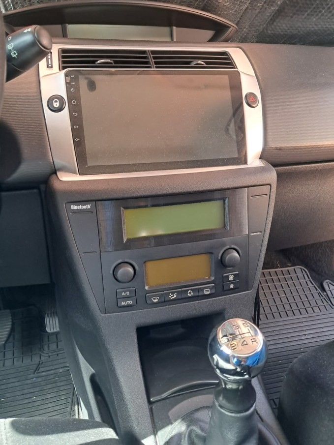
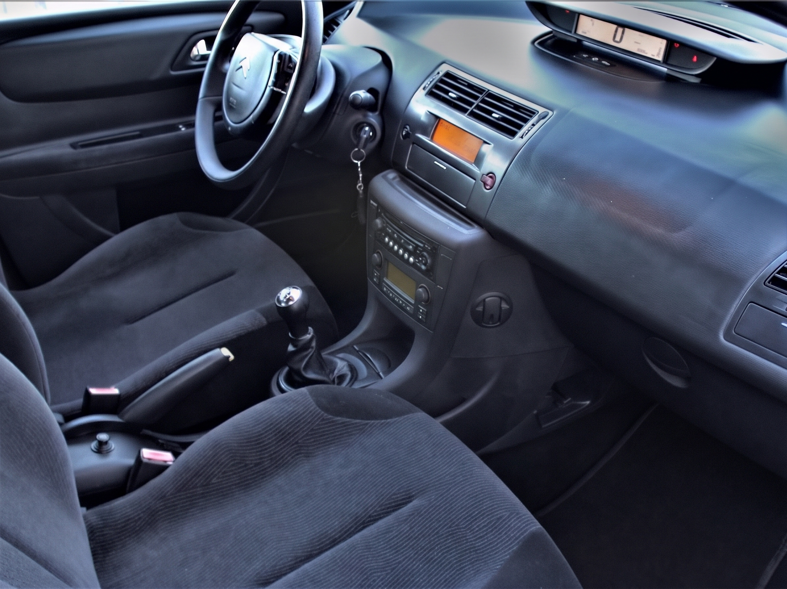
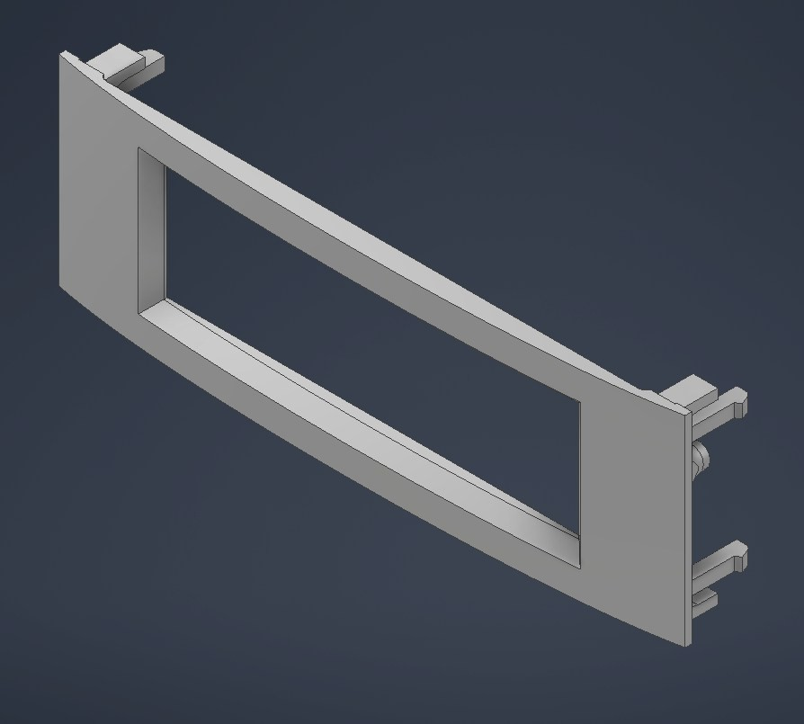
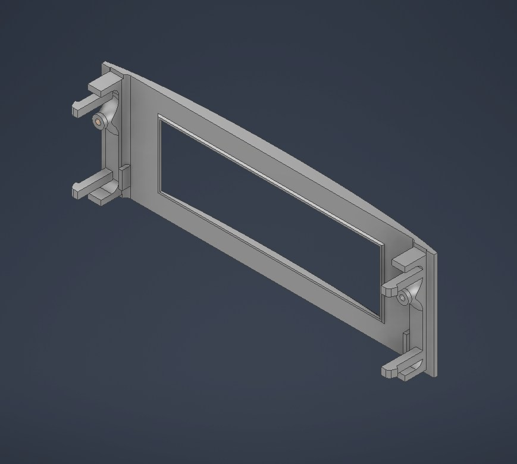
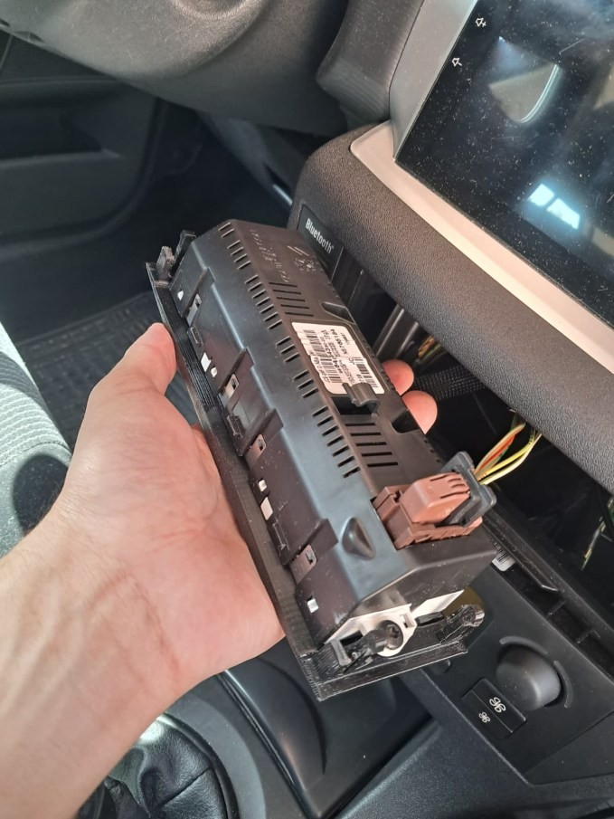
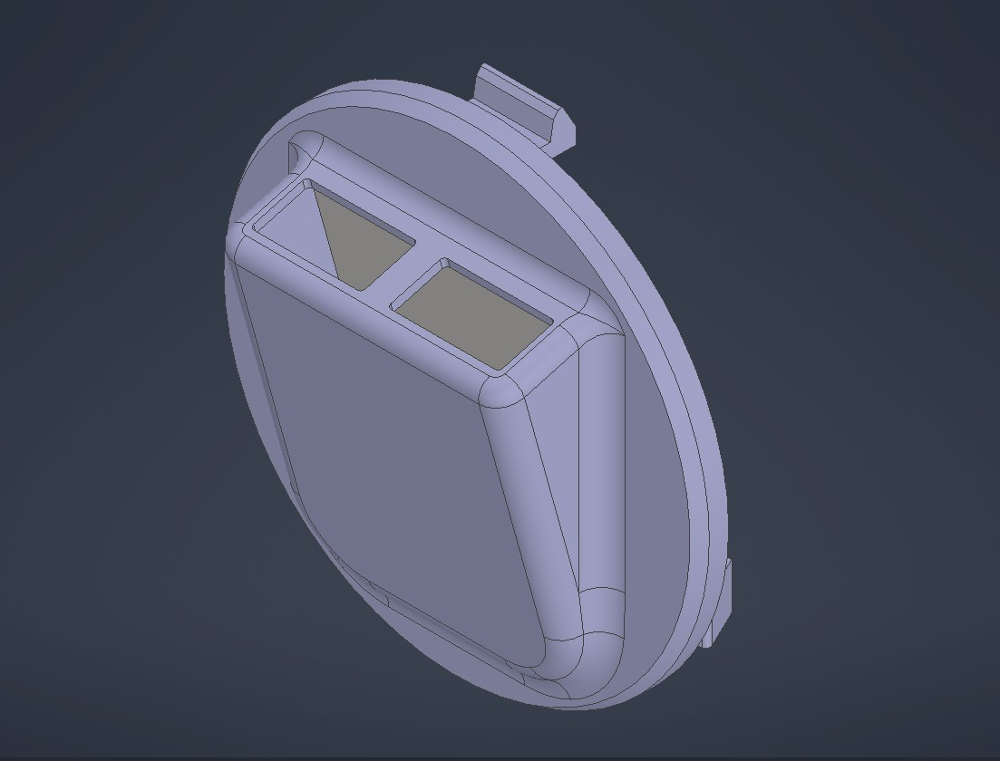
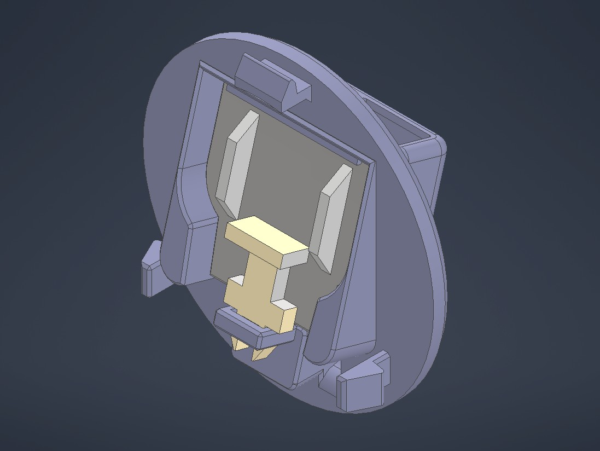
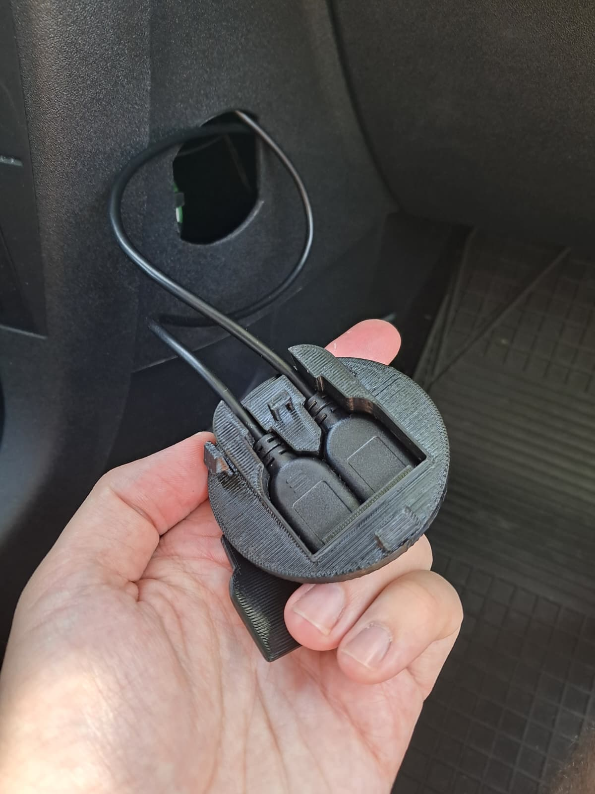
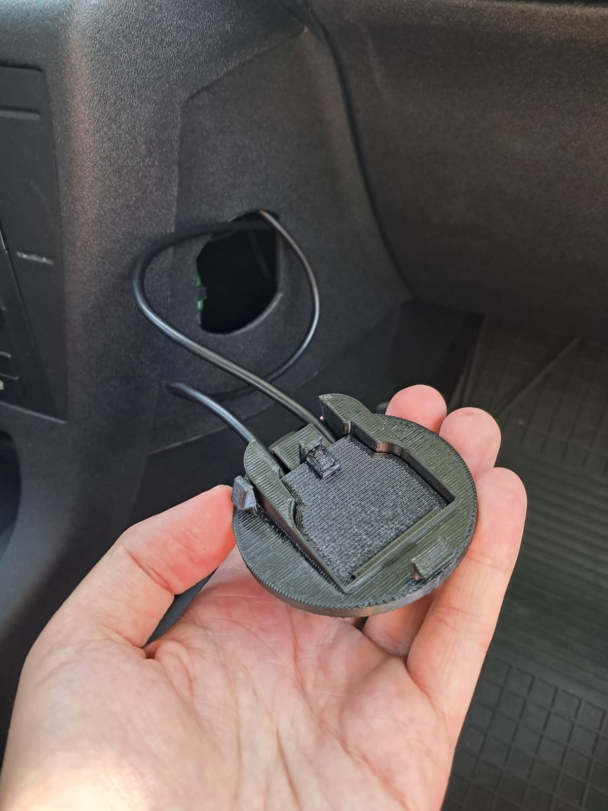
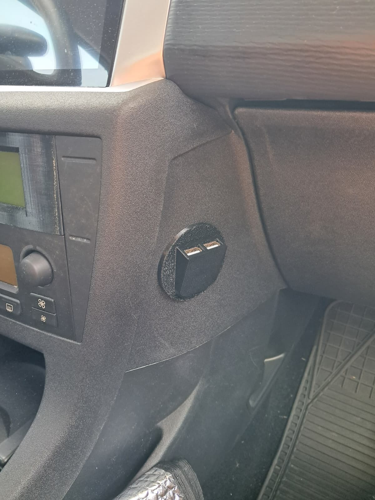

[← Back to Portfolio Home](../../)

# Automotive Interior Retrofit: OEM Display Relocation Bezel & Integrated Dual-USB Console Hub

### *Reverse Engineering, Snap-Fit Design & Thermal-Resistant Additive Manufacturing (2008 Citroën C4)*

<figure class="hero">
  
  <figcaption>Completed dashboard retrofit: Android Auto display in the upper bay and the relocated OEM computer screen in the lower bay.</figcaption>
</figure>

| **Role** | **Application Domain** | **Core Engineering Focus** | **Tools & Materials** |
| :--- | :--- | :--- | :--- |
| Product Design & Mechanical Engineer | Automotive Interior & Infotainment Retrofit | Reverse Engineering, Complex Curved Surfacing, Snap-Fit Design, Thermal Material Selection | Autodesk Inventor (Part & Assembly), OrcaSlicer, FDM 3D Printing, PETG, Manual Thread Tapping |

### Summary

- **Problem:** installing an Android Auto head unit in a 2008 Citroën C4 left the OEM onboard computer display without a place to go, and the new USB harnesses without a mounting port.
- **Solution A:** a 3D-printed adapter bezel that relocates the OEM display into the old radio bay, fastened with its original screws and held in the dashboard by custom snap-fit features.
- **Solution B:** a three-stage locking USB hub that replaces the OEM bag hook on the center console.
- **Material:** PETG, chosen for its thermal stability under solar load and its elastic compliance for snap-fit lugs.

<!-- TODO (optional): add measurable data, e.g. number of print iterations, interference fit values used, how long the parts have been installed. -->

**Contents:**
[1. Context & Challenge](#context) ·
[2. Sub-Project A: Display Bezel](#sub-a) ·
[3. Sub-Project B: Dual-USB Hub](#sub-b) ·
[4. Material Selection](#material)

---

## 1. Context & The Engineering Challenge

Modernizing the infotainment system of a **2008 Citroën C4** with an aftermarket **Android Auto** head unit (providing GPS navigation and Bluetooth connectivity) introduced two mechanical integration challenges within the vehicle cabin.

  <figure>
    
    <figcaption>Fig 0. Baseline state of the 2008 Citroën C4 center console before installing the Android Auto system, relocating the OEM display, and replacing the lateral console hook.</figcaption>
  </figure>

### Sub-Project A: OEM Onboard Computer Display Relocation

The new Android Auto screen was designed to occupy the upper dashboard bay that originally housed the vehicle's **OEM multifunction onboard computer display**. Meanwhile, the original factory radio, located in the lower DIN bay, became obsolete after the upgrade.

However, discarding the original onboard computer screen was not viable, as it displays critical vehicle telemetry, warning diagnostics, and configuration menus. The best solution was to **remove the obsolete radio and relocate the OEM onboard screen into the lower radio cavity**. This presented three mechanical hurdles:

1. **Dimensional mismatch:** the OEM screen is significantly smaller than the radio bay aperture, leaving no native structural support.
2. **Complex automotive surfacing:** the dashboard opening features compound organic curves typical of automotive interior trim.
3. **Non-destructive retention:** the adapter had to secure the OEM display using its original threaded fasteners, while locking into the dashboard cavity exclusively through custom **snap-fit interfaces**.

### Sub-Project B: Center Console Dual-USB Integration Hub

The aftermarket head unit included two wired USB extension harnesses (for smartphone charging and flash drive media playback), but the cabin had no native pass-through or mounting port. To avoid loose cables in the cockpit, I engineered a replacement for the OEM bag hook on the right flank of the center console (facing the passenger footwell). It turns that spot into a flush, dual-port USB hub, locked in place by curved snap-fit geometry.

---

## 2. Sub-Project A: OEM Display Adapter Bezel (CAD & Assembly)

### Reverse Engineering & Mechanical Design in Autodesk Inventor

Capturing the compound curvature of the radio cavity and replicating the OEM retention mechanics required careful dimensional measurement and rapid iterative prototyping to dial in the interference tolerances.

* **Compound curve replication:** the outer perimeter of the bezel was lofted and contoured in **Autodesk Inventor** to match the organic dashboard profile, giving a flush, factory-like finish.
* **Custom snap-fit retention:** compliant perimeter snap-fit features, modeled after the original radio retention mechanics, hold the assembly firmly against road vibrations without permanent dashboard modifications.
* **Post-print tapped threads:** instead of relying on fragile 3D-printed threads, the internal mounting bosses were modeled with calibrated pilot holes and **manually tapped** after printing. This allows the OEM display to be fastened with the vehicle's original screws.

  <figure>
    
    <figcaption>Fig 1. Front isometric view of the custom adapter bezel modeled in Autodesk Inventor, matching the curved dashboard profile.</figcaption>
  </figure>
  <figure>
    
    <figcaption>Fig 2. Rear isometric view detailing the structural ribs, perimeter snap-fit geometry, and bosses for manual thread tapping.</figcaption>
  </figure>

### Physical Assembly & Dashboard Integration

  <figure>
    
    <figcaption>Fig 3. OEM onboard display fastened to the tapped PETG frame using the original screws and connected to the vehicle wiring harness.</figcaption>
  </figure>
  <figure>
    
    <figcaption>Fig 4. Completed dashboard retrofit: Android Auto display in the upper bay and relocated OEM computer screen snap-fitted into the lower radio slot.</figcaption>
  </figure>

---

## 3. Sub-Project B: Dual-USB Console Port Module (Multi-Part Locking Mechanism)

To integrate the two loose USB female connectors cleanly into the right side of the center console, I designed a multi-component retention system. It replaces the original bag hook and withstands the repeated axial forces of plugging and unplugging.

### 3-Stage Mechanical Locking Architecture

1. **Contoured housing and curved snap-fit:** the main body replicates the curved mating surface and snap-fit clip geometry of the OEM console hook, and orients both USB ports upward for ergonomic access.
2. **Custom form-fitting internal slots:** the interior cavity has stepped channels tailored to the overmolded heads of both USB cables, preventing lateral play and rotational twist.
3. **Rear retainer plate and transverse locking pin:** to keep the connectors from being pushed back into the console during cable insertion, a flat rear plate closes the cavity behind the connector shoulders. A dedicated **transverse locking pin** secures the plate, giving a rigid, tool-free assembly.

  <figure>
    
    <figcaption>Fig 5. Front isometric CAD view showing the contoured bezel and dual top-facing USB apertures.</figcaption>
  </figure>
  <figure>
    
    <figcaption>Fig 6. Rear isometric CAD view highlighting the curved console snap-fit interface and transverse pin guide.</figcaption>
  </figure>

### Assembly Sequence & In-Vehicle Deployment

  <figure>
    
    <figcaption>Fig 7. Stage 1: USB connector heads seated inside the custom-fitted internal slots.</figcaption>
  </figure>
  <figure>
    
    <figcaption>Fig 8. Stage 2: connectors axially locked by the rear flat retainer plate and secured with the transverse pin.</figcaption>
  </figure>
  <figure>
    
    <figcaption>Fig 9. Stage 3: module snap-fitted into its final position on the center console, providing accessible dual USB ports.</figcaption>
  </figure>

---

## 4. Material Selection & Thermal Engineering (Why PETG?)

A critical requirement for automotive interior components is **thermal stability under solar load**. In summer, a parked cabin acts as a greenhouse, and dashboard surface temperatures routinely reach 60 °C to 80 °C.

* **Why PLA fails in automotive cabins:** standard PLA has a low glass transition temperature (Tg ≈ 55–60 °C). Under sustained cabin heat, a PLA bezel carrying the cantilevered weight of the OEM display, plus the continuous stress of the snap-fit joints, would suffer **thermal creep, stress relaxation, and permanent warping**.
* **PETG selection and slicing strategy:** both assemblies were sliced in **OrcaSlicer** and fabricated in **PETG** (Tg ≈ 80–85 °C). Besides its better thermal resistance, PETG has higher elongation at break and more flexural compliance, which matters for snap-fit lugs that must deform elastically during installation without brittle fracture.

---

[← Back to Portfolio Home](../../)
