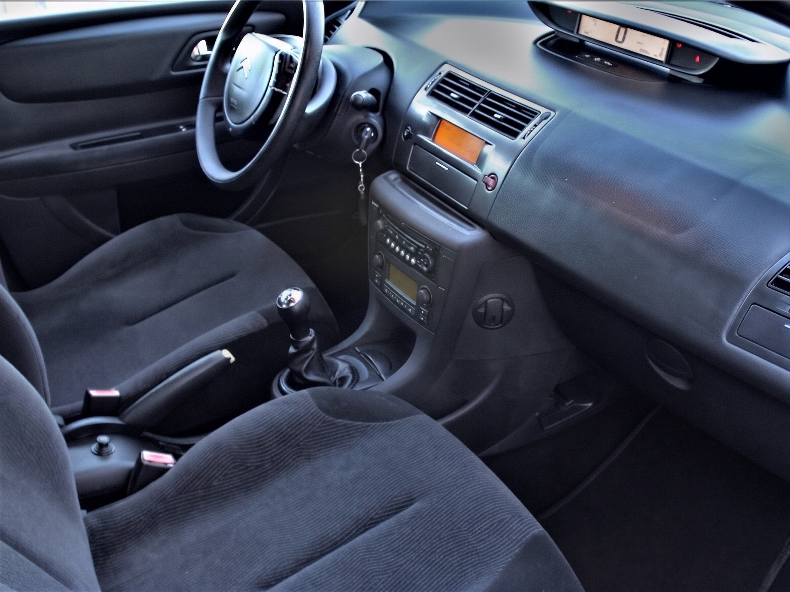
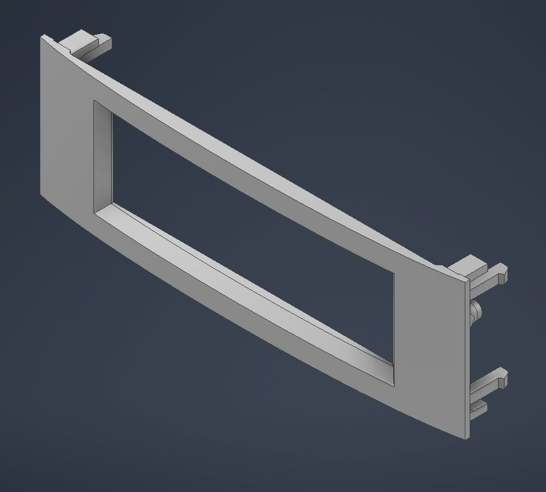
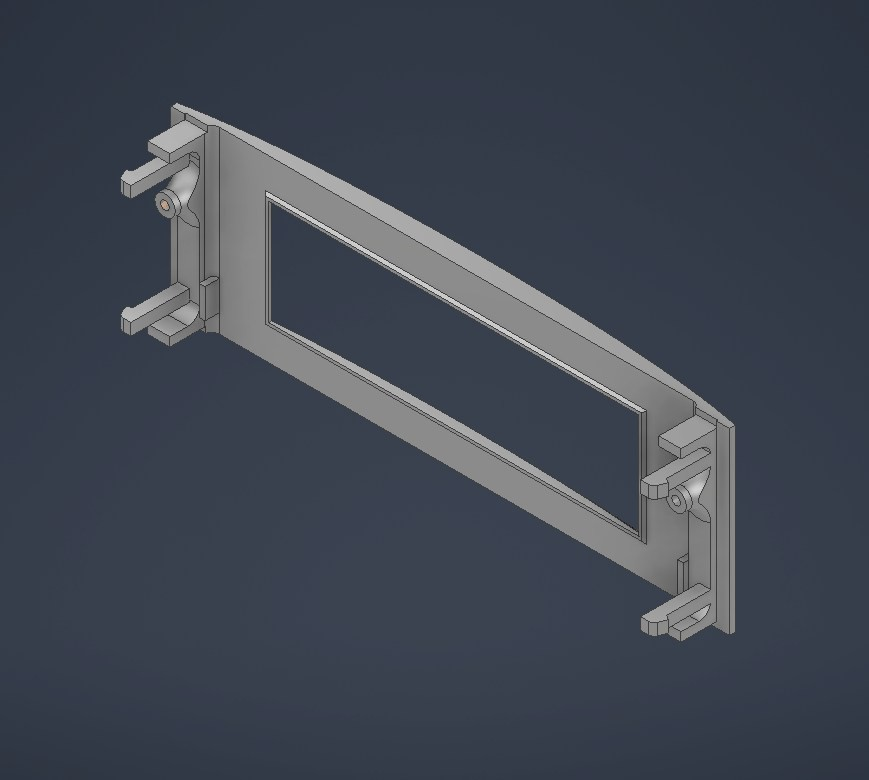
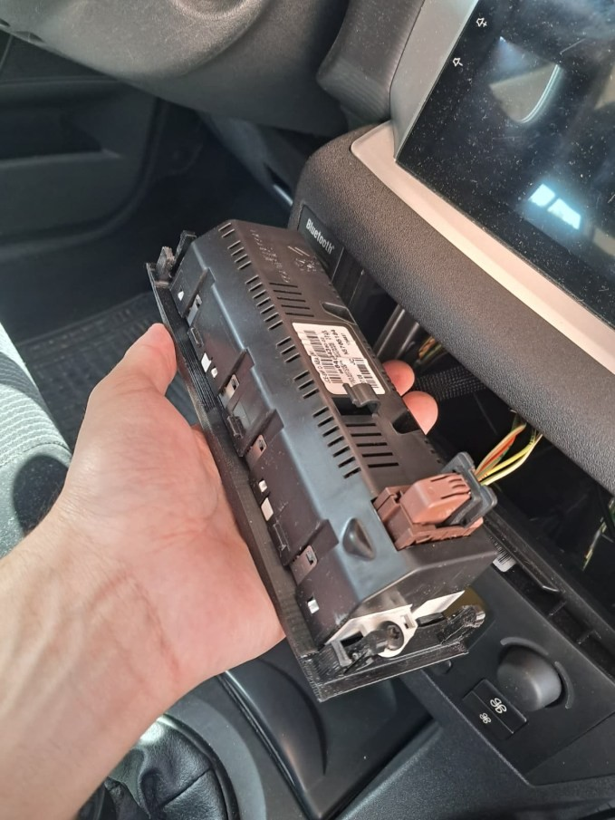
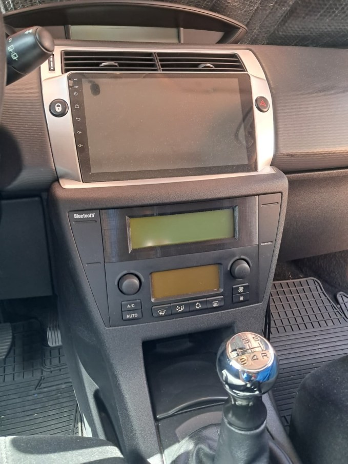
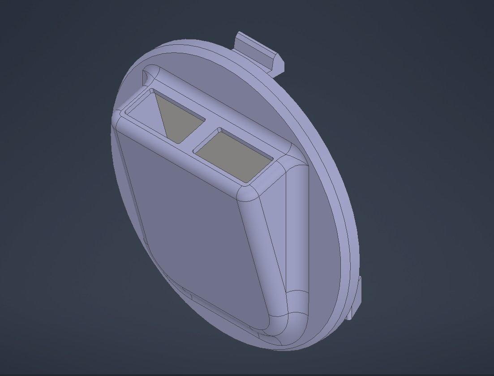
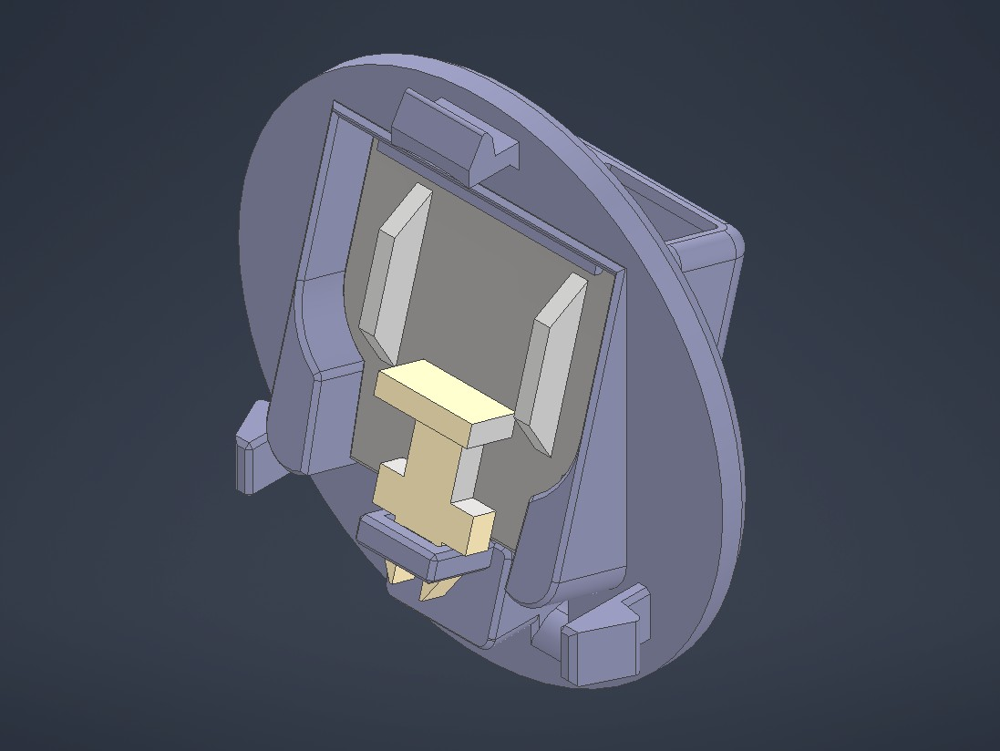

[← Back to Portfolio Home](../../)

# Automotive Interior Retrofit: OEM Display Relocation Bezel & Integrated Dual-USB Console Hub

### *Reverse Engineering, Snap-Fit Kinematics & Thermal-Resistant Additive Manufacturing (2008 Citroën C4)*

| **Role** | **Application Domain** | **Core Engineering Focus** | **Tools & Materials** |
| :--- | :--- | :--- | :--- |
| Product Design & Mechanical Engineer | Automotive Interior & Infotainment Retrofit | Reverse Engineering, Complex Curved Surfacing, Press-Fit / Snap-Fit Design, Thermal Material Selection | Autodesk Inventor (Part & Assembly), OrcaSlicer, FDM 3D Printing, PETG, Manual Thread Tapping |

---

## 1. Context & The Engineering Challenge

Modernizing the infotainment system of a **2008 Citroën C4** with an aftermarket **Android Auto** head unit (providing GPS navigation and Bluetooth connectivity) introduced two mechanical integration challenges within the vehicle cabin.

*Fig 0. Baseline state of the 2008 Citroën C4 center console prior to installing the Android Auto system, relocating the OEM display, and replacing the lateral console hook.*

### Sub-Project A: OEM Onboard Computer Display Relocation
The new Android Auto screen was designed to occupy the upper dashboard bay originally housing the vehicle's **OEM multifunction onboard computer display**. Meanwhile, the original factory radio—located in the lower DIN bay—was rendered completely obsolete by the upgrade. 

However, discarding the original onboard computer screen was not viable, as it displays critical vehicle telemetry, warning diagnostics, and configuration menus. The optimal engineering solution was to **remove the obsolete radio and relocate the OEM onboard screen into the lower radio cavity**. This presented three mechanical hurdles:
1. **Dimensional Mismatch:** The OEM screen envelope is significantly smaller than the radio bay aperture, leaving no native structural support.
2. **Complex Automotive Surfacing:** The dashboard opening features compound organic curves typical of automotive interior trim.
3. **Non-Destructive Retention:** The adapter needed to secure the OEM display using its original threaded fasteners while locking into the dashboard cavity exclusively via custom **press-fit interfaces**.

### Sub-Project B: Center Console Dual-USB Integration Hub
The aftermarket head unit included two wired USB extension harnesses (for smartphone charging and flash drive media playback), but the cabin lacked a native pass-through or mounting port. To avoid loose cables in the cockpit, I engineered a replacement module for an OEM bag hook located on the right flank of the center console (facing the passenger footwell), transforming it into a flush, dual-port USB hub locked via curved press-fit geometry.

---

## 2. Sub-Project A: OEM Display Adapter Bezel (CAD & Assembly)

### Reverse Engineering & Mechanical Design in Autodesk Inventor
Capturing the compound curvature of the radio cavity and replicating the OEM retention kinematics required careful dimensional metrology and rapid iterative prototyping to dial in interference tolerances.

* **Compound Curve Replication:** The outer perimeter of the bezel was lofted and contoured in **Autodesk Inventor** to match the organic dashboard profile seamlessly, ensuring a flush, factory-like aesthetic.
* **Custom Press-Fit Retention:** Integrated compliant perimeter press-fit features modeled after the original radio retention mechanics to hold the assembly firmly against road vibrations without permanent dashboard modifications.
* **Post-Print Tapped Threads:** Rather than relying on fragile 3D-printed threads, the internal mounting bosses were modeled with calibrated pilot holes and **manually tapped** post-printing. This allowed the OEM display to be fastened securely using the vehicle's original screws.

| Front Isometric CAD — Display Bezel | Rear Isometric CAD — Mounting & Press-Fits |
| :---: | :---: |
|  |  |
| *Fig 1. Front isometric view of the custom adapter bezel modeled in Autodesk Inventor, matching the curved dashboard profile.* | *Fig 2. Rear isometric view detailing the structural ribs, perimeter press-fit geometry, and bosses for manual thread tapping.* |

### Physical Assembly & Dashboard Integration

| Rear Sub-Assembly & Harness Connection | Final Cockpit Integration (Upper & Lower Bays) |
| :---: | :---: |
|  |  |
| *Fig 3. OEM onboard display fastened to the tapped PETG frame using original screws and connected to the vehicle wiring harness.* | *Fig 4. Completed dashboard retrofit: Android Auto display in the upper bay and relocated OEM computer screen press-fitted into the lower radio slot.* |

---

## 3. Sub-Project B: Dual-USB Console Port Module (Multi-Part Locking Mechanism)

To integrate the two flying USB female connectors cleanly into the right side of the center console, I designed a multi-component mechanical retention system that replaces the original cabin bag hook while resisting repetitive plug/unplug axial forces.

### 3-Stage Mechanical Locking Architecture
1. **Contoured Housing & Curved Press-Fit:** The main body replicates the curved mating surface and press-fit clip geometry of the OEM console hook, orienting both USB ports upward for ergonomic access.
2. **Custom Form-Fitting Internal Slots:** The interior cavity features stepped channels precisely tailored to the overmolded heads of both USB cables, preventing lateral play and rotational twist.
3. **Rear Retainer Plate & Transverse Locking Pin:** To prevent the USB connectors from being pushed backward into the console during cable insertion, a flat rear locking plate closes the cavity behind the connector shoulders. This plate is mechanically secured in place by a dedicated **transverse locking pin**, creating a rigid, tool-free assembly.

| Front Isometric CAD — Dual-USB Hub | Rear Isometric CAD — Press-Fit & Pin Interface |
| :---: | :---: |
|  |  |
| *Fig 5. Front isometric CAD view showing the contoured bezel and dual top-facing USB apertures.* | *Fig 6. Rear isometric CAD view highlighting the curved console press-fit interface and transverse pin guide.* |

### Assembly Sequence & In-Vehicle Deployment

| Stage 1: Form-Fit USB Seating | Stage 2: Rear Plate & Pin Locking | Stage 3: Final Console Installation |
| :---: | :---: | :---: |
|  |  |  |
| *Fig 7. USB connector heads seated inside the custom-molded internal slots.* | *Fig 8. Connectors axially locked by the rear flat retainer plate and secured via the transverse pin.* | *Fig 9. Module press-fitted into its final position on the center console, providing accessible dual USB ports.* |

---

## 4. Material Selection & Thermal Engineering (Why PETG?)

A critical engineering requirement for automotive interior components is **thermal stability under solar load**. During summer months, a parked vehicle cabin acts as a greenhouse, with dashboard surface temperatures routinely reaching $60\text{ }^\circ\text{C}$ to $80\text{ }^\circ\text{C}$.

* **Why PLA Fails in Automotive Cabins:** Standard PLA exhibits a low glass transition temperature ($T_g \approx 55\text{ }^\circ\text{C}$–$60\text{ }^\circ\text{C}$). Under sustained cabin heat, a PLA bezel bearing the cantilevered weight of the OEM display and continuous mechanical stress from the press-fit joints would suffer rapid **thermal creep, stress relaxation, and permanent warping**.
* **PETG Selection & Slicing Strategy:** Both assemblies were sliced in **OrcaSlicer** and fabricated in **PETG** ($T_g \approx 80\text{ }^\circ\text{C}$–$85\text{ }^\circ\text{C}$). In addition to superior thermal resistance, PETG offers higher elongation at break and flexural compliance—essential properties for snap-fit and press-fit lugs that must deform elastically during installation without brittle fracture.

---

[← Back to Portfolio Home](../../)