[← Back to Main Portfolio](../../)

# Modular Biomedical Platform for Photonic & Electrochemical Biosensing (Project TALES)

**Design, calibration, and additive manufacturing of an optomechanical experimentation platform with laser micro-positioning control for Organ-on-a-Chip (OoC) devices.**

<figure class="hero">
  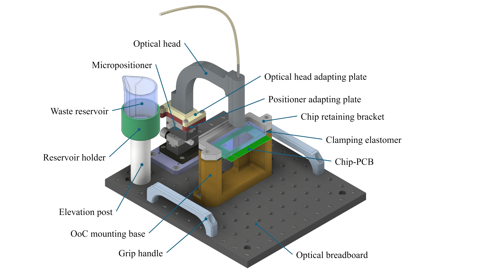
  <figcaption>Final CAD assembly (v1) of the platform, with top-down optical interrogation and lateral handles.</figcaption>
</figure>

| Project Details | Specifications |
| :--- | :--- |
| **Institution / Client** | Center for Biomedical Technology (CTB-UPM) — *Project TALES* (as part of my bachelor's thesis in Industrial Design) |
| **Role** | Lead Product Development & Mechanical Design Engineer |
| **Engineering Focus** | Optomechanical Design, DFMA / DFAM, Rapid Prototyping, Technical Documentation |
| **Software & Tools** | Autodesk Inventor, OrcaSlicer, Standardized CNC & Additive Technical Drawings |
| **Hardware & Manufacturing** | FDM 3D Printing (PLA / PETG), GMT Europe XY Stage, Thorlabs Optical Components |

### Summary

- **Problem:** improvised laboratory setups caused optical misalignment, poor repeatability and long setup times when measuring Organ-on-a-Chip devices.
- **Solution:** a modular, 3D-printed chassis on a Thorlabs optical breadboard, with an XY micro-positioning stage covering a 25 mm × 25 mm scanning area.
- **Cost:** only one component was purchased (the GMT Europe stage, 249 €); everything else was reused from laboratory stock or 3D printed.
- **Result:** the platform is in active use at CTB-UPM for optical biosensing measurements on the TALES chip.

<!-- TODO (optional): add measurable results here, e.g. setup time before/after, alignment error, positioning repeatability. -->

**Contents:**
[1. Context & Challenge](#context) ·
[2. Methodology & CAD](#methodology) ·
[3. Validation & Iteration](#validation) ·
[4. Calibration & Final Manufacturing](#manufacturing) ·
[5. Implementation & Scalability](#implementation) ·
[6. Next Steps](#next-steps)

---

## 1. Context & Engineering Challenge

Within **Project TALES** at the Center for Biomedical Technology (CTB-UPM), biomedical assays on neural networks using **Organ-on-a-Chip (OoC)** microfluidic devices faced a critical bottleneck at the macro-to-micro interface.

Without a unified mechanical chassis, researchers relied on improvised, *ad hoc* laboratory setups to align optical fibers with photonic biosensors (resonant nanopillars, RNPs) and manage fluidic peripherals. This caused:

* **Optical misalignment** of the laser beam over the sensing region.
* **Lack of measurement repeatability** and mechanical instability during testing.
* **Excessive setup times** and ergonomic fatigue for laboratory personnel.

  <figure>
    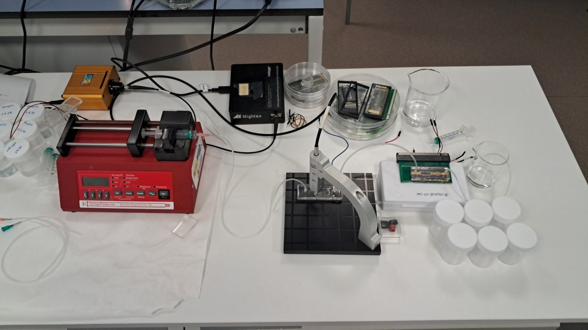
    <figcaption>Fig 1. Previous improvised setup, before the integrated platform design.</figcaption>
  </figure>
  <figure>
    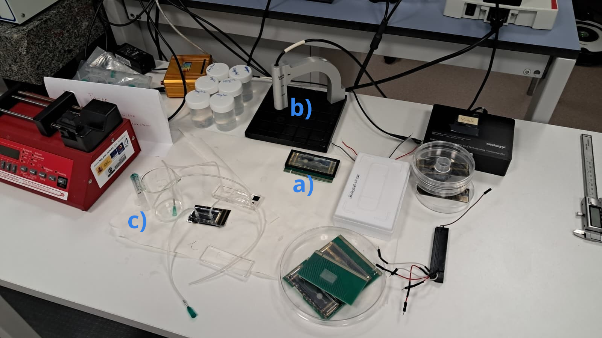
    <figcaption>Fig 2. Non-unified elements: (a) OoC with integrated PCB, (b) optical head and fiber, (c) fluidic reservoir and tubing.</figcaption>
  </figure>

### Project Objectives

1. **Mechanical unification:** securely house the microfluidic chip, integrated PCB, and fluidic peripherals in a single modular chassis.
2. **Optical precision:** guarantee perpendicular laser incidence and bidirectional micro-positioning across a **25 mm × 25 mm** scanning area.
3. **Future-proof modularity:** reserve structural volume and define mechanical interfaces for the future integration of a Multi-Electrode Array (MEA) electronic acquisition subsystem.

---

## 2. Methodology & CAD Engineering (Iteration v0)

The development followed a hybrid methodology combining **Design Thinking** (rapid ideation and physical validation) with **Total Design** (rigorous Product Design Specification [PDS] definition and objective concept selection via Pugh matrices). Every component was engineered under **DFMA** (Design for Manufacturing and Assembly) and **DFAM** (Design for Additive Manufacturing) principles.

### Key Initial Decisions

* **Mechanical fastening and thread durability:** directly printed threads were discarded for manufacturing reasons (insufficient printer resolution). Instead, the structural holes were modeled with a **Ø3.6 mm pre-drill diameter** for manual tapping with an **M4 × 0.7 tap**, ensuring reliable metal-to-polymer fastening.
* **Damage-free chip retention:** a custom chip retainer with an elastic rubber gasket clamps the delicate Organ-on-a-Chip and PCB assembly without inducing compressive stress fractures.
* **Optomechanical integration:** a bidirectional XY linear positioning stage (**GMT Europe MC-A**) provides precise and ergonomic operation.
* **Modularity:** every element is coupled to a **Thorlabs** optical breadboard, allowing easy configuration changes and design expansions.
* **Material reuse:** only the GMT Europe micropositioner was acquired externally, for just **249 €**. Every other component came from laboratory stock and was adapted with the 3D-printed parts.

  <figure>
    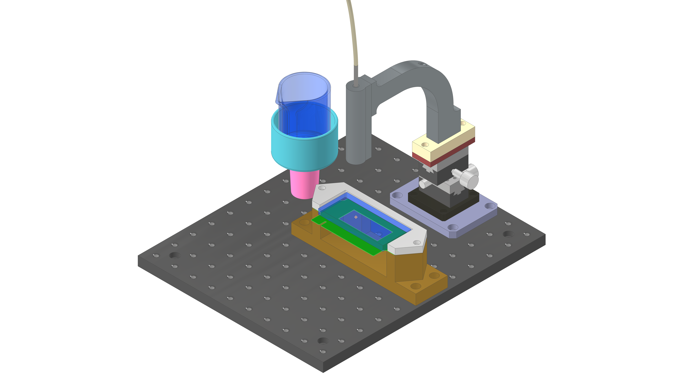
    <figcaption>Fig 3. Initial digital assembly (v0) modeled in Autodesk Inventor.</figcaption>
  </figure>
  <figure>
    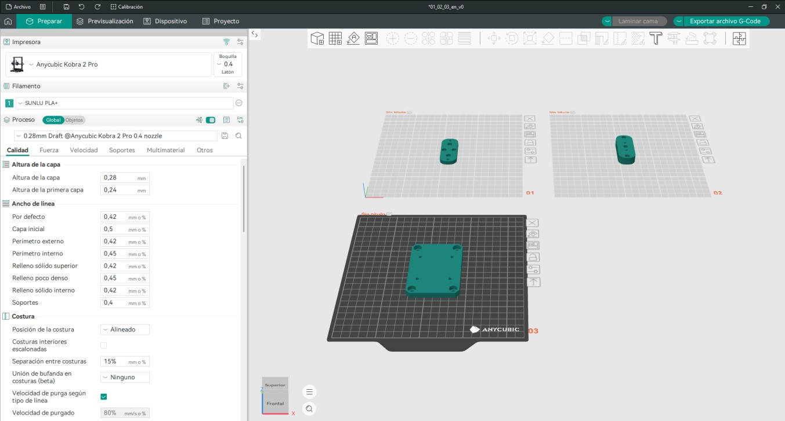
    <figcaption>Fig 4. Orientation and toolpath preparation of the stage adapter and connector plates in OrcaSlicer.</figcaption>
  </figure>

---

## 3. Physical Validation & Design Iteration (v0 → v1)

A functional **v0 prototype** was fabricated in PLA to validate assembly clearances, optical focal distance, and ergonomics in the laboratory.

  <figure>
    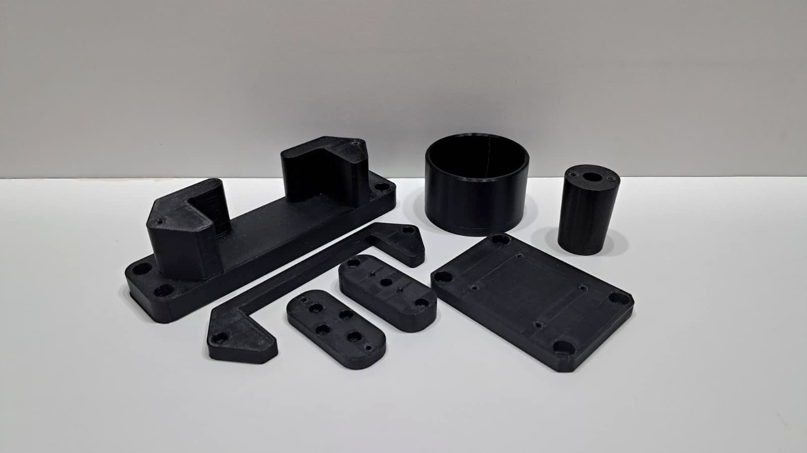
    <figcaption>Fig 5. Complete set of v0 prototype components printed in PLA.</figcaption>
  </figure>
  <figure>
    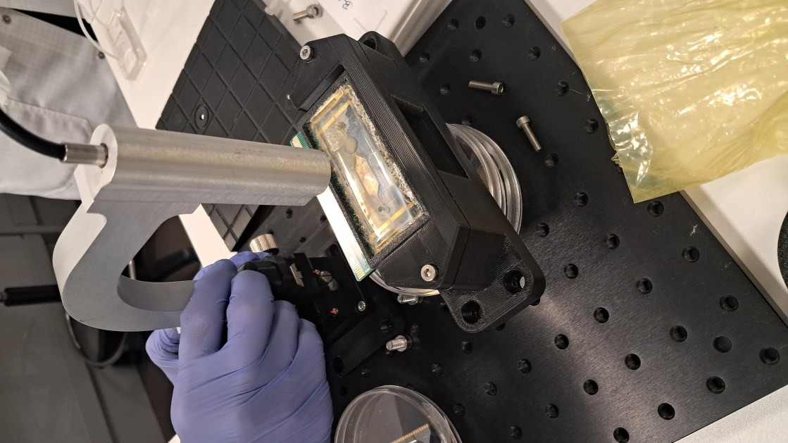
    <figcaption>Fig 6. Physical validation revealing the need to elevate the microfluidic device to match the fiber focal height.</figcaption>
  </figure>

### Findings from v0 Testing & Project Evolution

1. **Focal height correction:** empirical testing showed that the microfluidic chip required vertical elevation to align its sensing surface with the optical fiber focal plane (*Fig 6*).
2. **Agile adaptation to a new chip architecture:** mid-project, the TALES consortium relocated the resonant nanopillars to the **top surface of the chip**. The modular CAD architecture allowed a rapid geometric redesign of the optical head bracket. Since each function is held by a single part, the design proved resilient to this change.
3. **Ergonomics and transport:** integrated lateral handles were added to allow safe transport of the fully assembled setup between laboratory benches.

---

## 4. Process Calibration & Final Manufacturing (v1 in PETG)

To ensure resistance to common laboratory solvents (such as isopropanol and ethanol) and to improve creep resistance, the final **v1 platform** was transitioned from PLA to **PETG (Raise3D)** on an **Anycubic Kobra 2 Pro**.

<strong>Experimental material calibration (OrcaSlicer) — click to expand</strong>

Before printing the final functional components, a metrological and process calibration protocol was executed:

* **Extrusion temperature:** optimized via temperature tower testing to **245 °C**, maximizing interlayer adhesion without stringing.
* **Flow ratio and kinematics:** extrusion multiplier calibrated at **0.95**, retraction distance at **1 mm**, and *Pressure Advance* tuned to prevent corner bulging on mating kinematic surfaces.
* **Dimensional compensation:** hole-and-shaft interference fits were verified with dedicated tolerance test gauges before manufacturing the final assembly.

  <figure>
    
    <figcaption>Fig 7. Final optimized CAD assembly (v1) with top-down optical interrogation and lateral handles.</figcaption>
  </figure>
  <figure>
    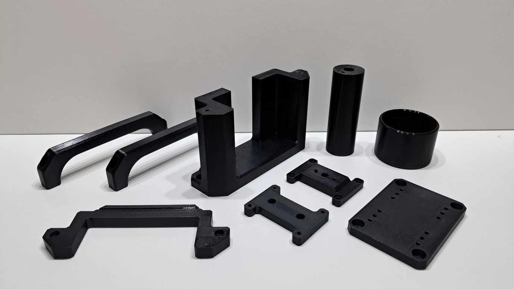
    <figcaption>Fig 8. Definitive v1 components printed in calibrated PETG.</figcaption>
  </figure>

---

## 5. Laboratory Implementation & Industrial Scalability

Beyond additive manufacturing, a complete package of **standardized technical drawings** was produced, specifying geometric tolerances and surface finishes suited to future **CNC machining in aluminum alloys**. This route may be needed if PETG does not meet the precision requirements in the long term.

The v1 platform was assembled on the Thorlabs optical breadboard and deployed at the **Center for Biomedical Technology (CTB-UPM)**, where it is actively used for optical biosensing measurements on the TALES chip.

  <figure>
    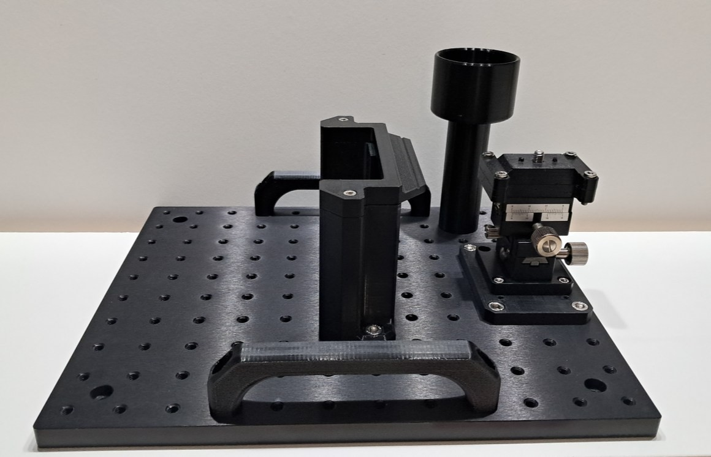
    <figcaption>Fig 9. Full optomechanical assembly mounted on the optical breadboard.</figcaption>
  </figure>
  <figure>
    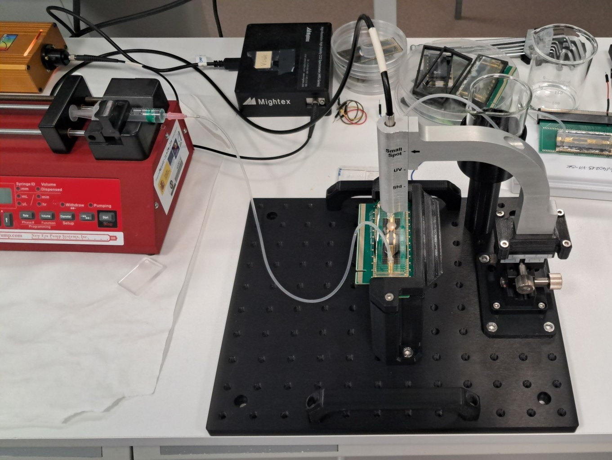
    <figcaption>Fig 10. Platform in active laboratory operation, measuring the TALES Organ-on-a-Chip device.</figcaption>
  </figure>

Considering upcoming expansions of the TALES project, the design reserves a large area of the optical breadboard for the future MEA acquisition system (still in development by the TALES team). Furthermore, the optical head can move across the vast majority of the OoC upper surface, which keeps measurements feasible if the RNPs are relocated again.

  <figure>
    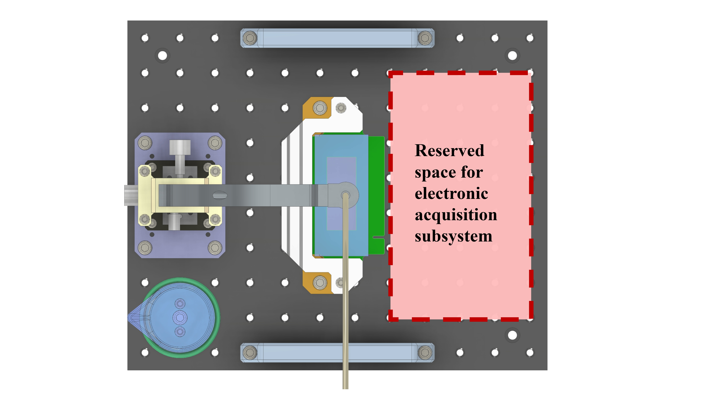
    <figcaption>Fig 11. CAD top view showing the space reserved for the electronic acquisition system.</figcaption>
  </figure>
  <figure>
    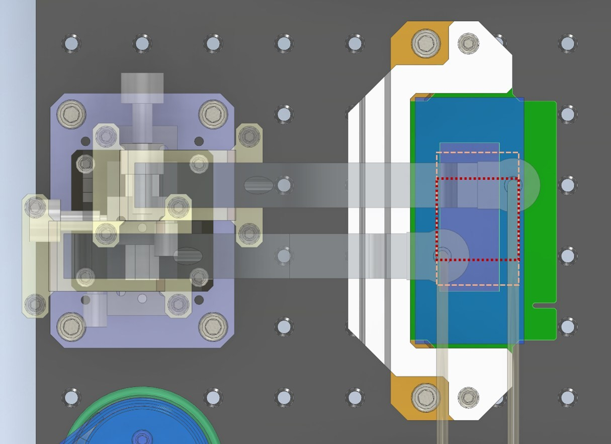
    <figcaption>Fig 12. CAD top view showing the optical head range of movement.</figcaption>
  </figure>

---

## 6. Next Steps

* Evaluate whether PETG keeps the required precision over long-term use, and move to CNC-machined aluminum if it does not.
* Integrate the MEA electronic acquisition subsystem in the reserved area of the breadboard, once the TALES team completes it.
* Quantify setup time and alignment repeatability against the previous ad hoc configuration.

---

[← Back to Main Portfolio](../../)
