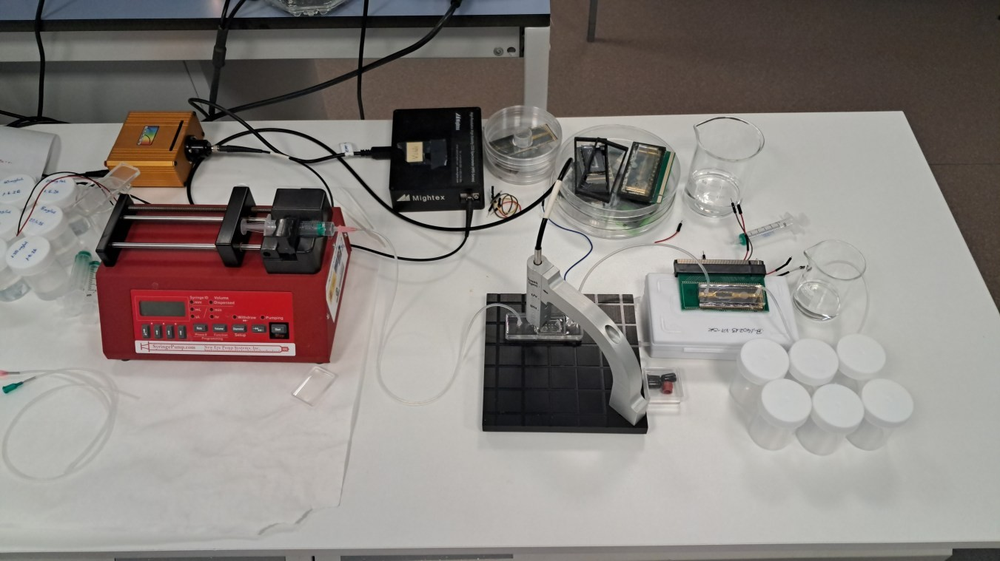
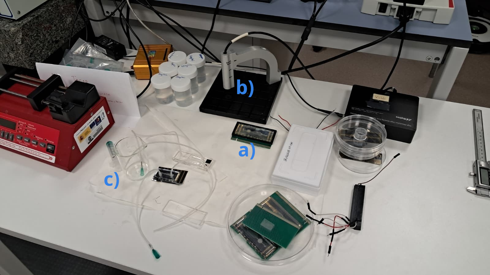
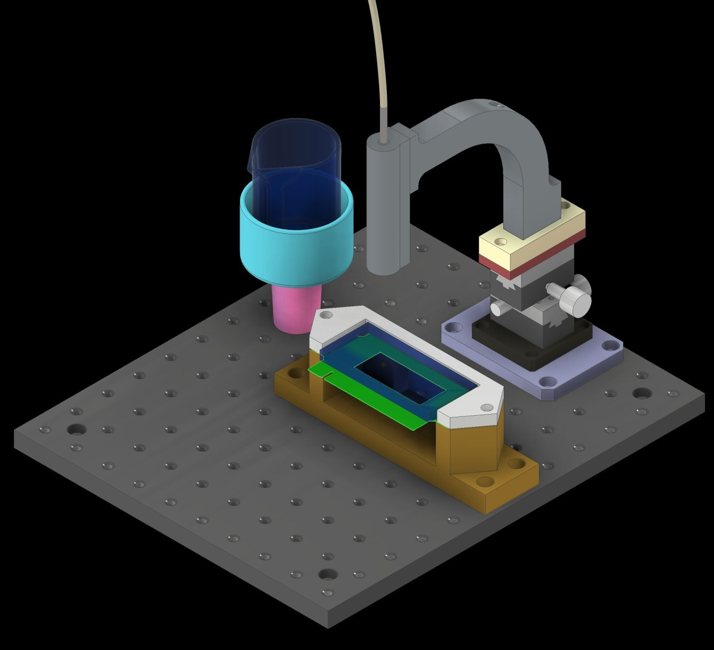
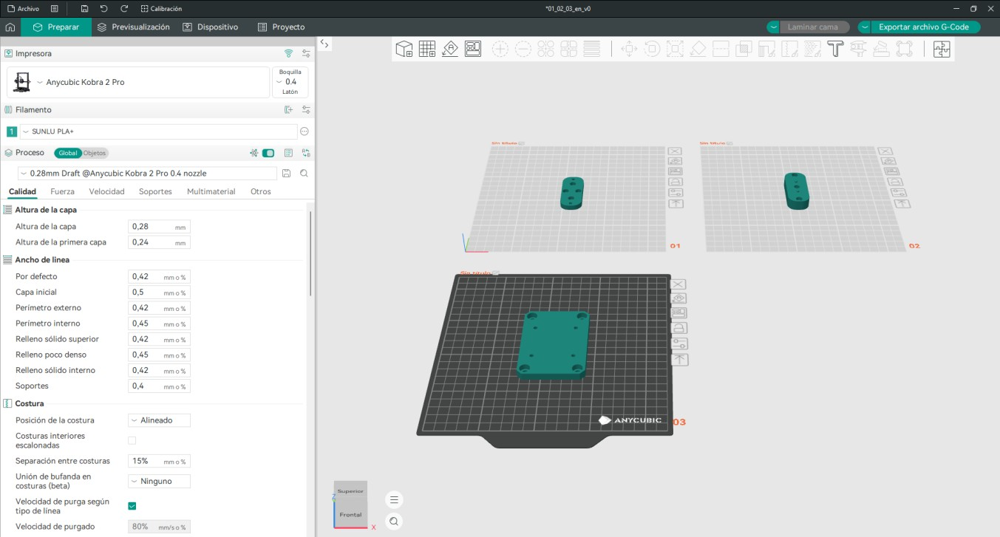
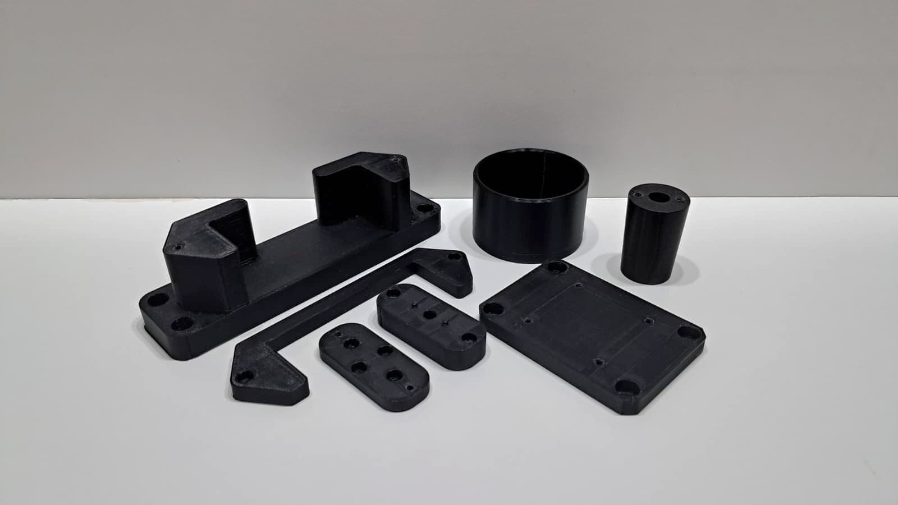
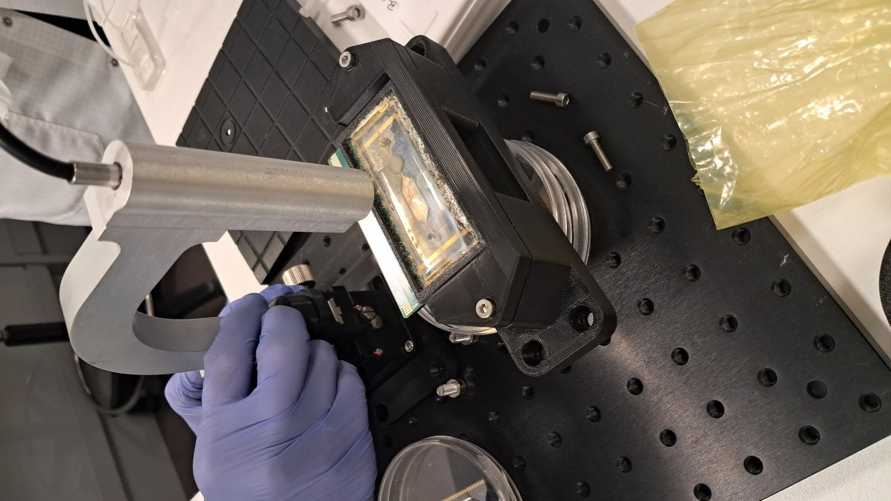
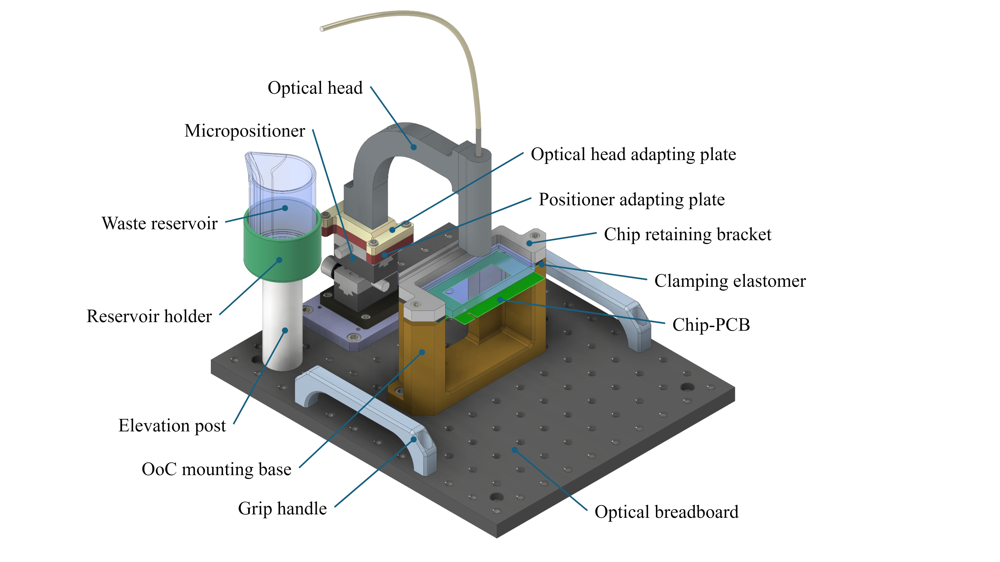
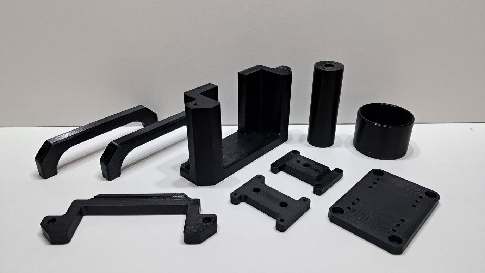
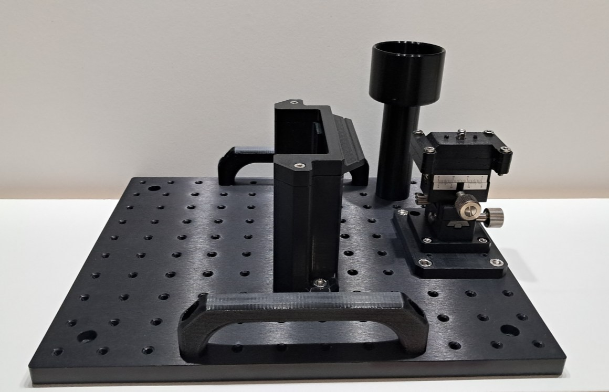
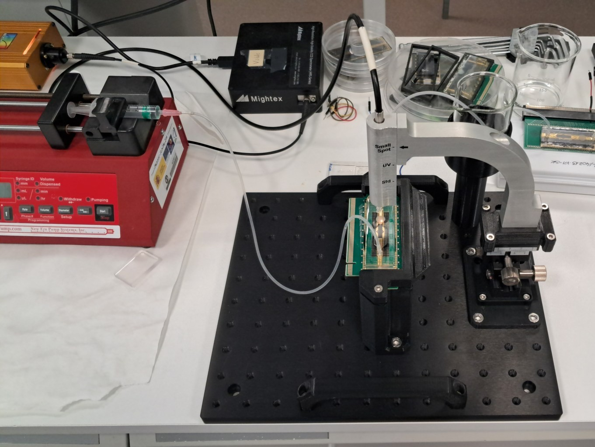

[← Back to Main Portfolio](../../)

# Modular Biomedical Platform for Photonic & Electrochemical Biosensing (Project TALES)

**Design, calibration, and additive manufacturing of an optomechanical experimentation platform with laser micro-positioning control for Organ-on-a-Chip (OoC) devices.**

| Project Details | Specifications |
| :--- | :--- |
| **Institution / Client** | Center for Biomedical Technology (CTB - UPM) — *Project TALES* |
| **Role** | Lead Product Development & Mechanical Design Engineer |
| **Engineering Focus** | Optomechanical Design, DFMA / DFAM, Rapid Prototyping, Technical Documentation |
| **Software & Tools** | Autodesk Inventor, OrcaSlicer, Standardized CNC & Additive Technical Drawings |
| **Hardware & Manufacturing** | FDM 3D Printing (PLA / PETG), GMT Europe XY Stage, Thorlabs Optical Breadboard |

---

## 1. Context & Engineering Challenge

Within **Project TALES** at the Center for Biomedical Technology (CTB-UPM), biomedical assays on *in vitro* neural networks using **Organ-on-a-Chip (OoC)** microfluidic devices faced a critical bottleneck at the macro-to-micro interface. 

Without a unified mechanical chassis, researchers relied on improvised, *ad-hoc* laboratory setups to align optical fibers with photonic biosensors (resonant nanopillars) and manage fluidic peripherals. This caused:
* **Optical misalignment** of the laser beam over the sensing region.
* **Lack of measurement repeatability** and mechanical instability during testing.
* **Excessive setup times** and ergonomic fatigue for laboratory personnel.

| Initial Ad-Hoc Setup at CTB-UPM | Unorganized Experimental Peripherals |
| :---: | :---: |
|  |  |
| *Fig 1. Previous improvised setup prior to the integrated platform design.* | *Fig 2. Ununified elements: (a) OoC with integrated PCB, (b) optical head & fiber, (c) fluidic reservoir & tubing.* |

### Project Objectives
1. **Mechanical Unification:** Securely house the microfluidic chip, integrated PCB, and fluidic peripherals in a single modular chassis.
2. **Optical Precision:** Guarantee perpendicular laser incidence and bidirectional micro-positioning across a **25 mm × 25 mm** scanning area.
3. **Future-Proof Modularity:** Reserve structural volume and define mechanical interfaces for the future integration of a Multi-Electrode Array (MEA) electronic acquisition subsystem.

---

## 2. Methodology & CAD Engineering (Iteration v0)

The development followed a hybrid methodology combining **Design Thinking** (rapid ideation and physical validation) with **Total Design** (rigorous Product Design Specification [PDS] definition and objective concept selection via Pugh Matrices). Every component was engineered under strict **DFMA** (Design for Manufacturing and Assembly) and **DFAM** (Design for Additive Manufacturing) principles.

### Key CAD Decisions in Autodesk Inventor
* **Mechanical Fastening & Thread Durability:** Direct 3D-printed threads were discarded due to shear fragility under repeated laboratory assembly. Instead, structural holes were modeled with a **Ø3.6 mm pre-drill diameter** for manual post-processing with an **M4 × 0.7 tap**, ensuring reliable metal-to-polymer fastening.
* **Damage-Free Chip Retention:** Designed a custom chip retainer incorporating an elastic rubber gasket to clamp the delicate Organ-on-a-Chip and PCB assembly without inducing compressive stress fractures.
* **Optomechanical Integration:** Coupled a bidirectional XY linear positioning stage (**GMT Europe MC-A**) onto a **Thorlabs** optical anchor plate.

| CAD Assembly — Prototype v0 | Slicing & DFAM Strategy in OrcaSlicer |
| :---: | :---: |
|  |  |
| *Fig 3. Initial digital assembly (v0) modeled in Autodesk Inventor.* | *Fig 4. Orientation and toolpath preparation of the stage adapter and connector plates in OrcaSlicer.* |

---

## 3. Physical Validation & Design Iteration (v0 → v1)

A functional **v0 prototype** was fabricated in PLA to validate assembly clearances, optical focal distance, and ergonomics in the laboratory.

| Manufactured v0 Prototype Components | Empirical Focal & Alignment Testing |
| :---: | :---: |
|  |  |
| *Fig 5. Complete set of v0 prototype components printed in PLA.* | *Fig 6. Physical validation revealing the need to elevate the microfluidic device to match the fiber focal height.* |

### Findings from v0 Testing & Project Evolution
1. **Focal Height Correction:** Empirical testing demonstrated that the microfluidic chip required vertical elevation to align its sensing surface with the optical fiber focal plane (*Fig 6*).
2. **Agile Adaptation to New Chip Architecture:** Mid-project, the TALES consortium relocated the resonant nanopillars to the **top surface of the chip**. The modular CAD architecture allowed a rapid geometric redesign of the optical head bracket to transition from horizontal to vertical top-down interrogation.
3. **Ergonomics & Transport:** Added integrated lateral handles to allow safe transport of the fully assembled setup between laboratory benches.

---

## 4. Process Calibration & Final Manufacturing (v1 in PETG)

To ensure resistance against common laboratory solvents (such as isopropanol and ethanol) and improve mechanical creep resistance, the final **v1 platform** was transitioned from PLA to **PETG (Raise3D)** on an **Anycubic Kobra 2 Pro**.

### Experimental Material Calibration (OrcaSlicer)
Prior to printing the final functional components, a metrological and process calibration protocol was executed:
* **Extrusion Temperature:** Optimized via temperature tower testing to **245 °C** to maximize interlayer adhesion without stringing.
* **Flow Ratio & Kinematics:** Calibrated extrusion multiplier at **0.95**, retraction distance at **1 mm**, and tuned *Pressure Advance* to prevent corner bulging on mating kinematic surfaces.
* **Dimensional Compensation:** Verified hole-and-shaft interference fits using dedicated tolerance test gauges prior to manufacturing the final assembly.

| Final CAD Assembly — Version 1 | Precision-Calibrated PETG Components (v1) |
| :---: | :---: |
|  |  |
| *Fig 7. Final optimized CAD assembly (v1) with top-down optical interrogation and lateral handles.* | *Fig 8. Definitive v1 components printed in calibrated PETG.* |

---

## 5. Laboratory Implementation & Industrial Scalability

Beyond additive manufacturing, a complete package of **standardized technical drawings** was produced, specifying geometric tolerances and surface finishes adapted for future **CNC machining in aluminum alloys** for small-batch series production.

The v1 platform was successfully assembled on the Thorlabs optical bench and deployed at the **Center for Biomedical Technology (CTB-UPM)**, where it is actively used for optical biosensing measurements on the TALES chip.

| Preliminary Benchtop Assembly (v1) | Real-World Implementation at CTB-UPM |
| :---: | :---: |
|  |  |
| *Fig 9. Full optomechanical assembly mounted on the optical breadboard.* | *Fig 10. Platform in active laboratory operation measuring the TALES Organ-on-a-Chip device.* |

---

[← Back to Main Portfolio](../../)