[← Back to Main Portfolio](../../)

  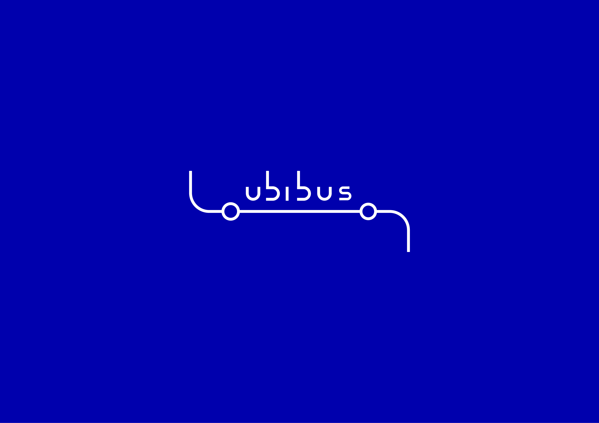

# UBIBUS — Hybrid Digital-Analog Smart Urban Transit Interface

**1st Prize Winner at the Ford Smart Mobility Challenge (UPM) and European Finalist at the Ford Smart Mobility Accelerator. A resilient, accessible urban furniture concept and functional hardware prototype designed to eliminate waiting uncertainty at public bus stops.**

<figure class="hero">
  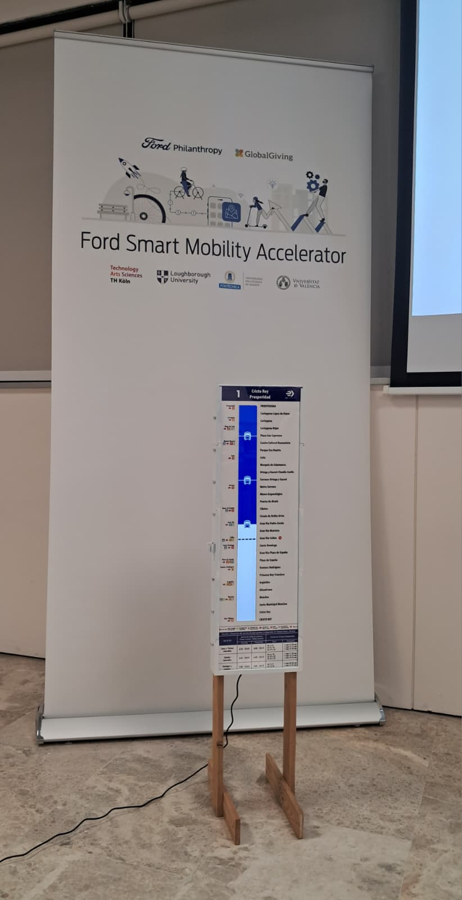
  <figcaption>Functional UBIBUS prototype running live during the 2026 European finale in Valencia.</figcaption>
</figure>

| Project Details | Specifications |
| :--- | :--- |
| **Competition & Awards** | **1st Prize** — Ford Smart Mobility Challenge (UPM, Oct 2025) **European Finalist** — Ford Smart Mobility Accelerator (Valencia, Oct 2026) |
| **Role** | Mechanical Design, Rapid Prototyping & Business/Financial Modeling Lead |
| **Team** | Multidisciplinary 3-person team (Mechanical Engineering, Industrial Design & Architecture) |
| **Engineering Focus** | Human-Centered Design, Remote Tolerance Analysis, DFAM, Multi-Part Enclosure Design, Rapid Prototyping |
| **Software & Tools** | Autodesk Inventor, OrcaSlicer, Inkscape, FFF 3D Printing (PLA), Woodworking & Surface Post-Processing |

### Summary

- **Problem:** passengers at bus stops suffer waiting anxiety because a single countdown number says little, and smartphone apps exclude non-digital users.
- **Solution:** a hybrid sign that merges the familiar printed route diagram with a 50 mm × 500 mm digital strip showing real-time bus positions. It works without a smartphone and keeps its core information if power is lost.
- **Phase 1:** a mechanical MVP built for under €30, which won 1st Prize at UPM (Oct 2025).
- **Phase 2:** a full-scale functional prototype, designed and built in Zurich without access to the screen, and assembled in Valencia within 24 hours of the pitch. The parts fitted on the first attempt.

<!-- TODO (optional): add measurable data, e.g. total prototype cost, number of printed parts, print hours, final weight, link to the pitch deck. -->

**Contents:**
[1. Context & Solution](#context) ·
[2. Phase 1: Low-Cost MVP](#phase-1) ·
[3. Phase 2: Distributed Hardware Engineering](#phase-2) ·
[4. DFAM Enclosure & Structure](#dfam) ·
[5. Final Integration in Valencia](#final)

---

## 1. Context, Problem & Empathetic Solution

Developed between February 2025 and October 2026 within the **Ford Smart Mobility Challenge**, **UBIBUS** addresses one of the most persistent friction points in urban public transport: passenger frustration and perceived waiting anxiety caused by bus delays.

Overhauling traffic punctuality requires multi-decade urban replanning and institutional coordination. Changing **how real-time transit information is communicated to the passenger** is something product engineering can solve much sooner. Traditional digital displays at bus stops show a single countdown number (e.g., *"5 min"*) that often freezes or jumps without context, while smartphone GPS apps exclude non-digital users and present complex map interfaces.

  <figure>
    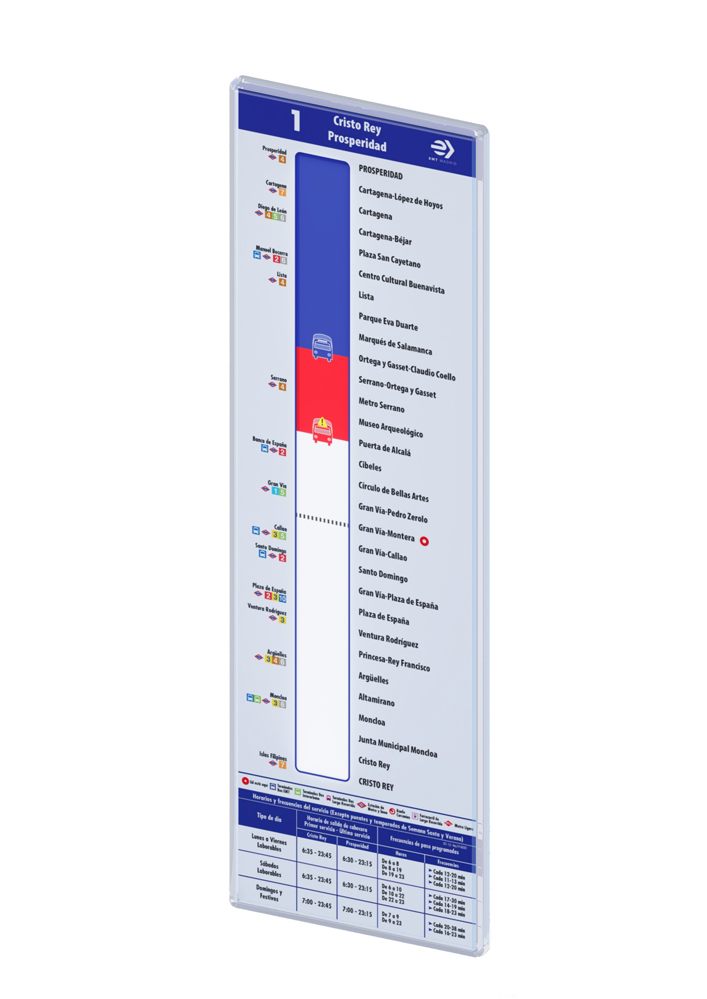
    <figcaption>Fig 1. Conceptual render of the UBIBUS hybrid transit sign.</figcaption>
  </figure>
  <figure>
    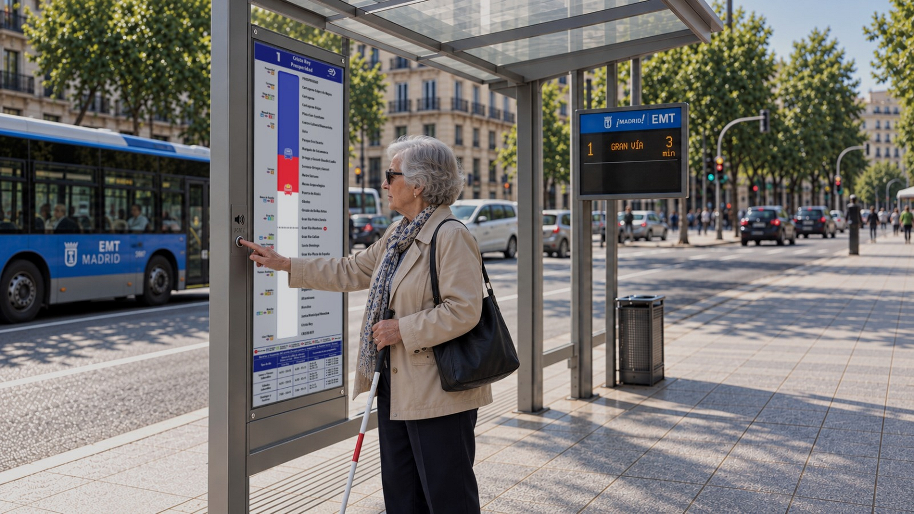
    <figcaption>Fig 2. Urban integration in Madrid, showing a passenger interacting with UBIBUS alongside the legacy countdown display.</figcaption>
  </figure>

### The Hybrid Digital-Analog Value Proposition

Instead of replacing the traditional vertical paper route diagram ("thermometer" line map) that passengers already understand intuitively, **UBIBUS** merges it with an embedded ultra-wide digital strip (**50 mm × 500 mm**):

* **Contextual spatial tracking:** displays the exact real-time position and movement of each bus directly along the physical sequence of stops.
* **Color-blind accessible status coding:** indicates operational state at a glance (**blue** for normal flow, **red** for traffic congestion, **gray** for out-of-service units), supplemented by incident icons, explanatory text at the bottom, and suggested alternative routes.
* **Universal, zero-barrier access:** embedded in the bus stop shelter as public urban furniture, it requires no smartphone, app download, or digital literacy, and includes an integrated **tactile audio-readout button for visually impaired users**.
* **Fail-safe resilience:** the stop sequence, origin, and destination stay printed on the paper poster that frames the screen, so the sign keeps its core informational value even during a complete power or telecom outage.

---

## 2. Phase 1: Design Thinking & Low-Cost Mechanical MVP (Oct 2025)

After collaborative ideation, user persona mapping, and *Design Thinking* workshops, our team divided responsibilities to maximize impact. I led the **physical prototyping strategy** and the **financial budgeting and business model validation**.

For the initial pitch competition at Universidad Politécnica de Madrid (October 2025) we had no external funding. Applying lean Minimum Viable Product (MVP) principles, I built a highly visual, low-cost mechanical prototype (**under €30 total budget**) to demonstrate the core hybrid interface to the jury:

* **Hybrid board architecture:** a modified printed route poster with a precision vertical cutout, mounted on a structural plywood backing board.
* **3D-printed kinematic bus sliders:** custom bus icons modeled in **Autodesk Inventor**, with lateral actuation rods that slide manually along the route cutout during the live pitch. They carry interchangeable color-coded inserts (blue for normal flow, red for traffic jams).

  <figure>
    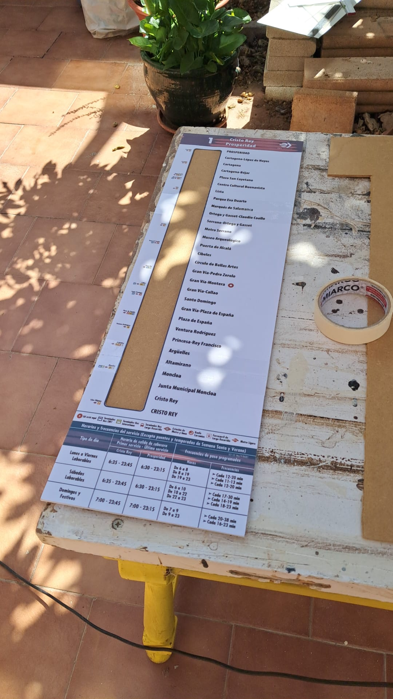
    <figcaption>Fig 3. Workshop fabrication of the low-cost hybrid MVP on a plywood base.</figcaption>
  </figure>
  <figure>
    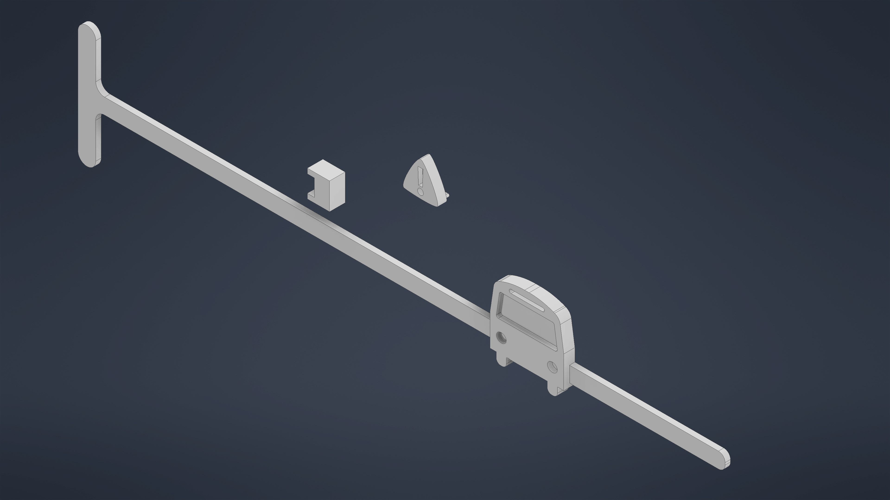
    <figcaption>Fig 4. Autodesk Inventor CAD model of the manually actuated sliding bus indicators.</figcaption>
  </figure>

### Phase 1 Outcome — 1st Prize Winner

The tangible clarity of the mechanical prototype made our pitch stand out. It secured **1st Prize at UPM**, seed funding to build a functional electronic prototype, and a place as finalists at the European **Ford Smart Mobility Accelerator** in Valencia.

  <figure>
    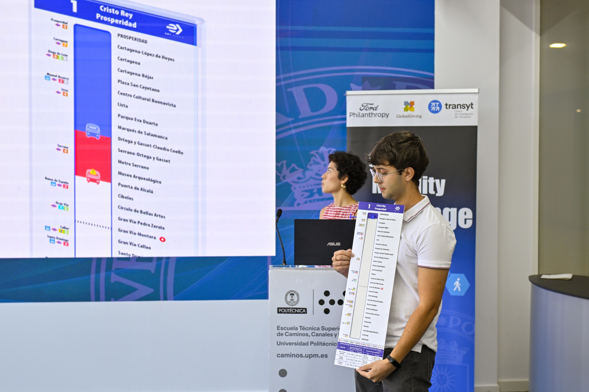
    <figcaption>Fig 5. Demonstrating the manual sliding MVP during the 2025 pitch.</figcaption>
  </figure>
  <figure>
    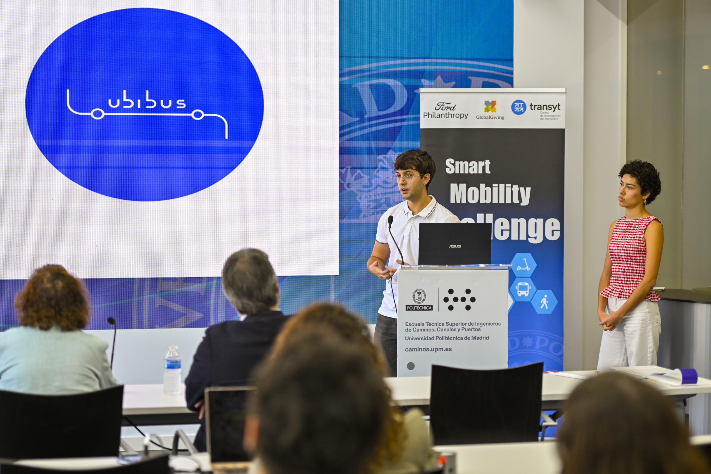
    <figcaption>Fig 6. Defending the technical and financial viability before the jury.</figcaption>
  </figure>
  <figure>
    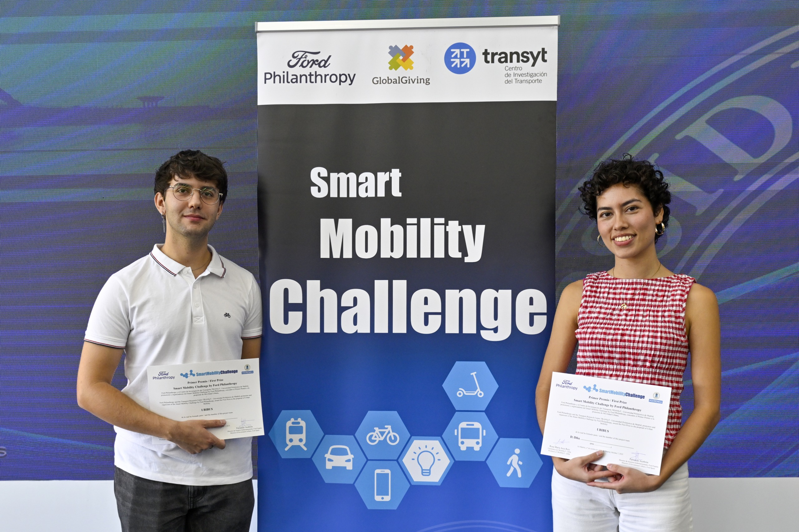
    <figcaption>Fig 7. Receiving the 1st Prize award at UPM.</figcaption>
  </figure>

---

## 3. Phase 2: Distributed Hardware Engineering & Functional Prototype (Oct 2026)

Reaching the European finale in Valencia required a fully functional, full-scale electronic prototype. It integrates a custom **50 mm × 500 mm ultra-wide display** running interactive transit software, together with the printed poster and a protective acrylic face.

### The Distributed Engineering & Logistics Challenge

During this phase our team worked from three European cities: I had relocated to **Zurich** (with my personal FFF 3D printer), Lucía was in **Madrid**, and Mafe was in **Berlin**.

To avoid risking damage to the fragile 500 mm LCD panel on international flights, we shipped the screen directly to Madrid. Lucía programmed the interface there and carried the panel safely by high-speed train to Valencia. As a result, I had to **design, manufacture, and pre-assemble the entire structural frame and electronic enclosure in Zurich without physical access to the screen**, under three strict constraints:

1. **Remote metrology and tolerance chains:** all mating interfaces for the screen and cabling were designed in CAD from measurements taken remotely in Madrid. Final integration would happen in Valencia just 24 hours before the pitch, so I designed deliberate **clearance tolerance stacks and adjustable retention margins** to guarantee first-time assembly success.
2. **Build volume partitioning:** the enclosure, longer than 500 mm, had to be printed on a compact desktop FFF machine (**220 × 220 × 300 mm** build volume).
3. **Airline carry-on transportability:** the whole structural totem and housing had to pack flat inside a standard cabin suitcase for the flight from Zurich to Valencia.

  <figure>
    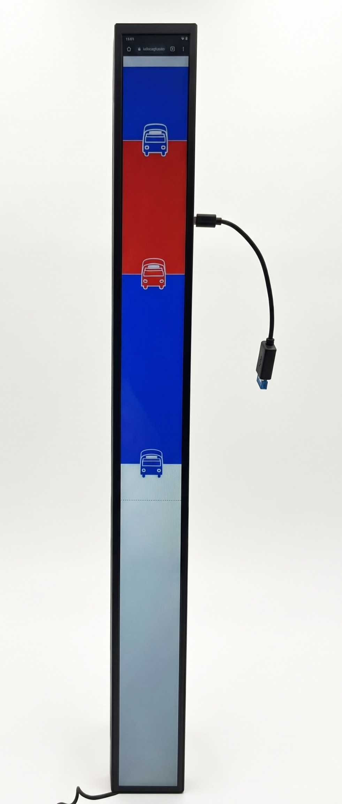
    <figcaption>Fig 8. Custom 50 × 500 mm display running the UBIBUS software interface.</figcaption>
  </figure>
  <figure>
    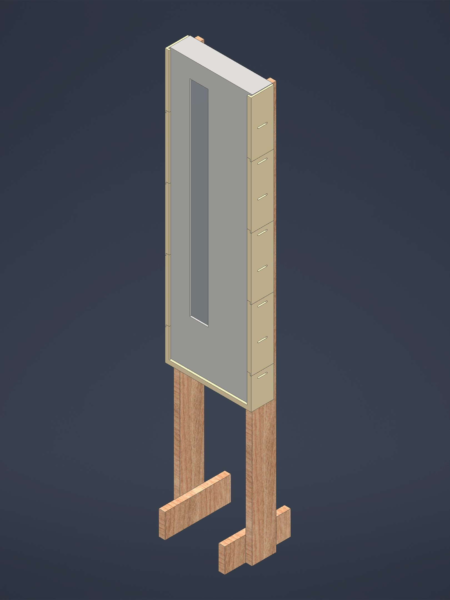
    <figcaption>Fig 9. Full Autodesk Inventor CAD assembly (front hybrid interface).</figcaption>
  </figure>
  <figure>
    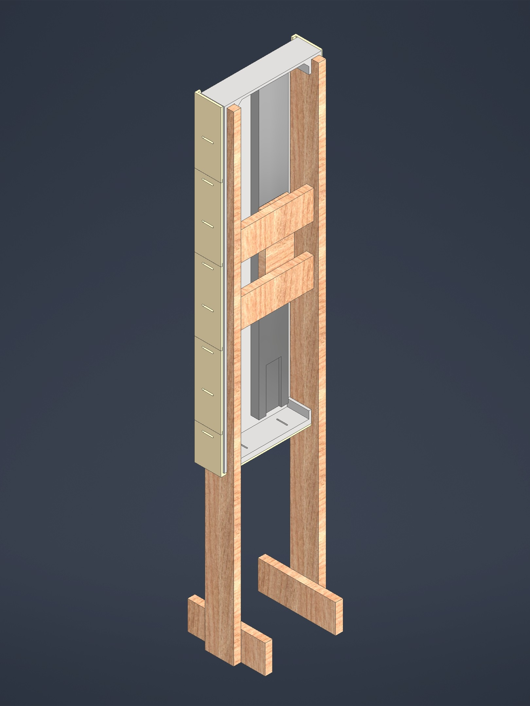
    <figcaption>Fig 10. Rear CAD view showing internal structural ribs and hardware housing.</figcaption>
  </figure>

---

## 4. DFAM Enclosure Fabrication & Modular Structure

### Multi-Part 3D-Printed Enclosure with Dovetail Joints

To overcome the 220 × 220 mm print bed limit while keeping the structure rigid across a half-meter span, I designed the PLA housing as a modular multi-piece assembly connected by **interlocking dovetail joints**.

Once printed and interlocked, the seams were bonded and filled with a custom composite paste of **fine wood dust and PVA adhesive**. Multi-stage sanding and a white finish then gave a unified, monolithic bezel.

  <figure>
    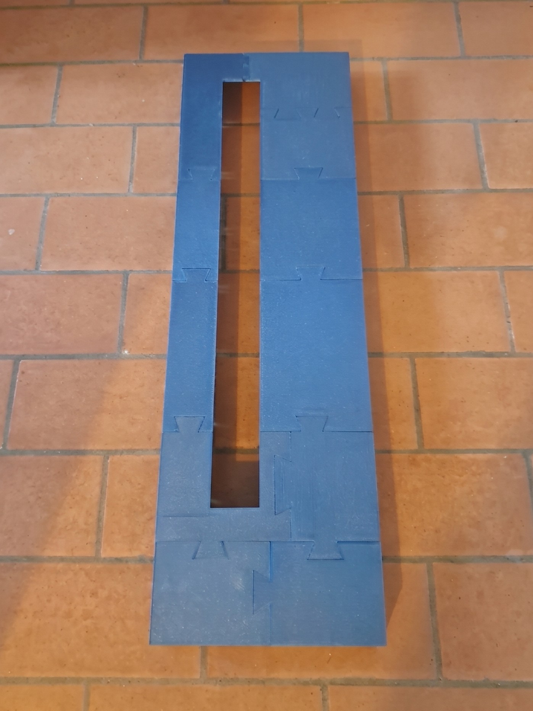
    <figcaption>Fig 11. Full-scale PLA enclosure assembled from segmented prints.</figcaption>
  </figure>
  <figure>
    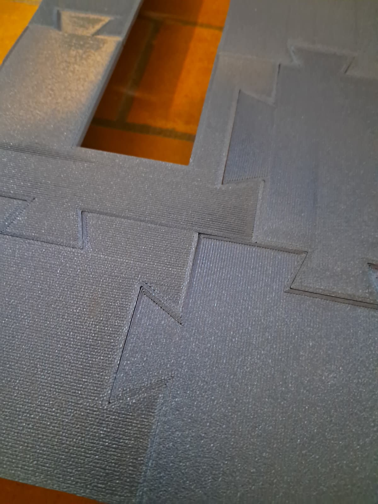
    <figcaption>Fig 12. Close-up of the interlocking dovetail geometry designed for alignment.</figcaption>
  </figure>
  <figure>
    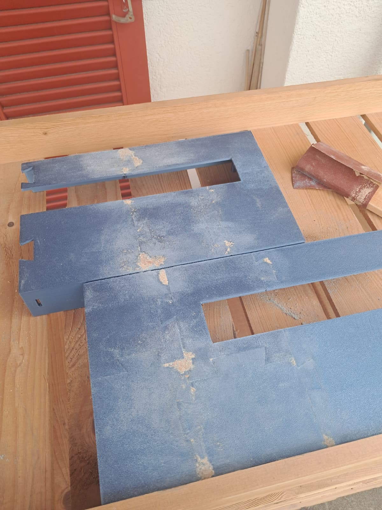
    <figcaption>Fig 13. Gap filling with wood-dust/PVA paste and surface sanding before painting.</figcaption>
  </figure>

### Upcycled Structural Frame & Knock-Down Luggage Joints

With only basic hand tools, shortly after relocating to Zurich, I reclaimed solid wood boards from a discarded street shelf to build the structural totem. The upper chassis was joined permanently in Zurich with dowels, screws, and PVA wood glue.

To fit the tall vertical legs inside a carry-on suitcase, I designed a **split two-piece leg architecture**. The halves are joined by custom **3D-printed structural splice plates** and bolted fasteners, which allow quick and rigid reassembly in Valencia.

  <figure>
    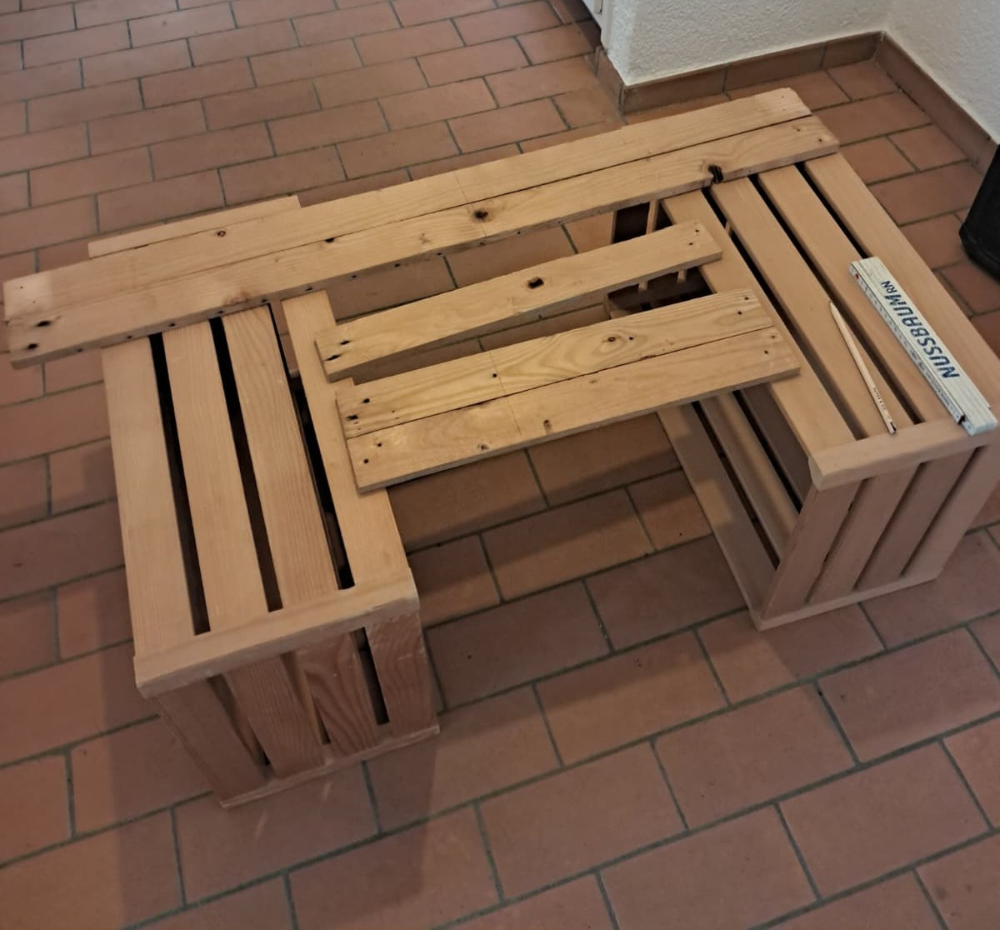
    <figcaption>Fig 14. Upcycled wood boards cut to size.</figcaption>
  </figure>
  <figure>
    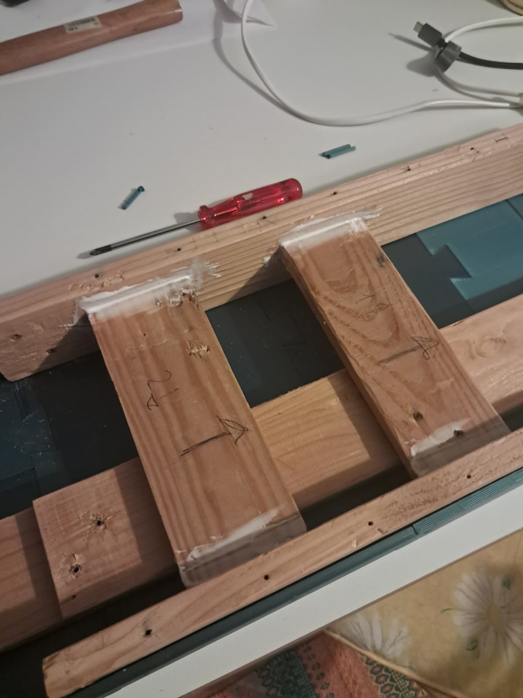
    <figcaption>Fig 15. Upper frame joined with dowels, screws, and PVA glue.</figcaption>
  </figure>
  <figure>
    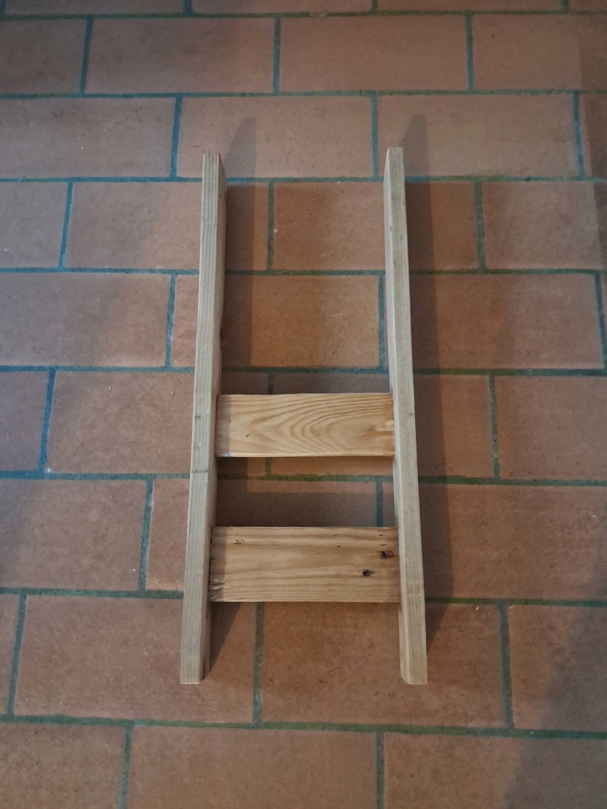
    <figcaption>Fig 16. Consolidated upper structural assembly.</figcaption>
  </figure>
  <figure>
    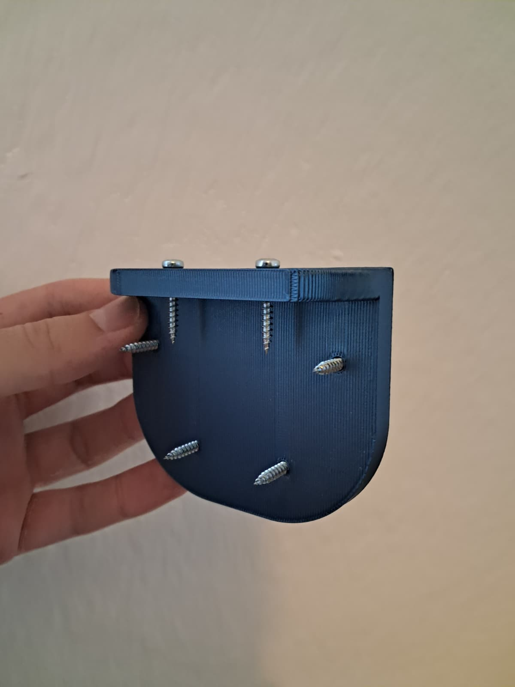
    <figcaption>Fig 17. Bolted 3D-printed splice plate enabling suitcase transport.</figcaption>
  </figure>

---

## 5. Final Integration & Ford Smart Mobility Accelerator (Valencia 2026)

Twenty-four hours before the final pitch in Valencia, the mechanical structure flown in from Zurich met the electronic hardware arriving from Madrid. Thanks to the pre-calculated tolerance allowances, the 50 × 500 mm screen, the printed route poster, and the protective front PMMA (acrylic) sheet fitted into the housing on the first attempt.

  <figure>
    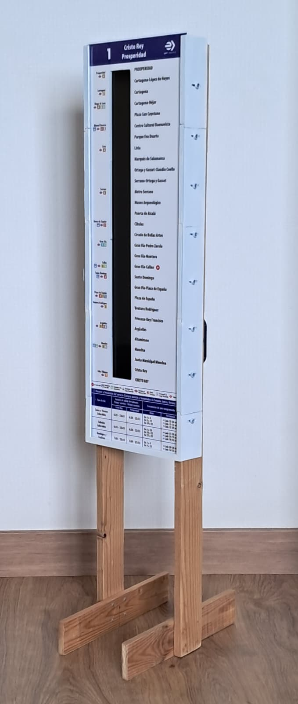
    <figcaption>Fig 18. Complete hardware-software integration in Valencia one day before the event.</figcaption>
  </figure>
  <figure>
    
    <figcaption>Fig 19. Functional prototype running live during the 2026 European finale.</figcaption>
  </figure>

### Live Prototype Operation & Team

The functional prototype enabled a dynamic, interactive pitch alongside the top winning university teams from across Europe. The jury and mentors praised how it combined physical industrial design, hardware robustness, and real-world urban empathy.

  <figure>
    <video controls preload="metadata">
      <source src="Fig21.mp4" type="video/mp4">
      Your browser does not support the video tag.
    </video>
    <figcaption>Fig 20. Video demonstration of the hybrid digital-analog display in active operation.</figcaption>
  </figure>
  <figure>
    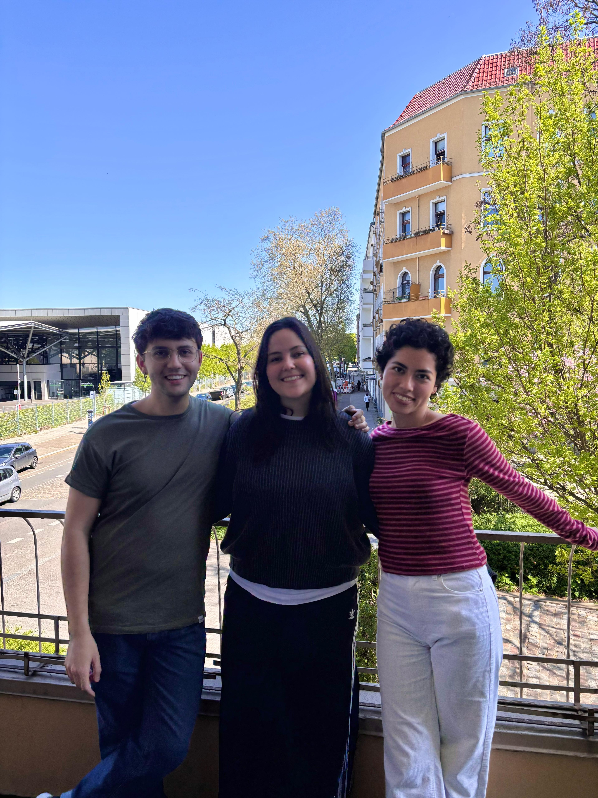
    <figcaption>Fig 21. The UBIBUS team (from left to right: Pablo, Mafe, and Lucía).</figcaption>
  </figure>

---

[← Back to Main Portfolio](../../)
