[← Back to Main Portfolio](../../)

  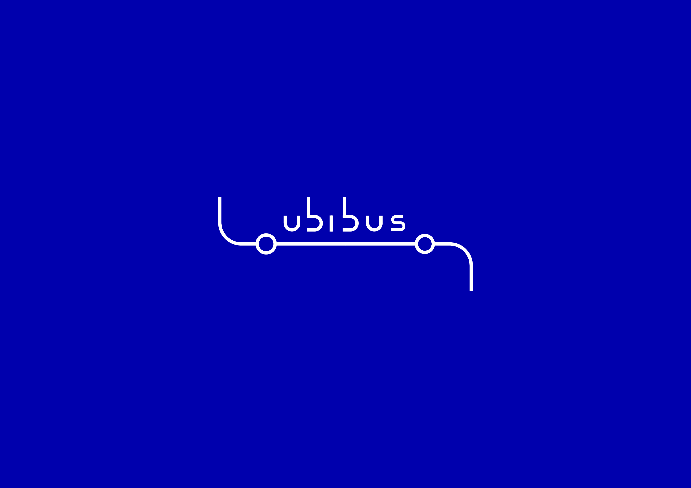

# UBIBUS — Hybrid Digital-Analog Smart Urban Transit Interface

**1st Prize Winner at the Ford Smart Mobility Challenge (UPM) & European Finalist at the Ford Smart Mobility Accelerator. A resilient, accessible urban furniture concept and functional hardware prototype designed to eliminate waiting uncertainty at public bus stops.**

| Project Details | Specifications |
| :--- | :--- |
| **Competition & Awards** | **1st Prize** — Ford Smart Mobility Challenge (UPM, Oct 2025) **European Finalist** — Ford Smart Mobility Accelerator (Valencia, Oct 2026) |
| **Role** | Mechanical Design, Rapid Prototyping & Business/Financial Modeling Lead |
| **Team** | Multidisciplinary 3-person team (Mechanical Engineering, Industrial Design & Architecture) |
| **Engineering Focus** | Human-Centered Design, Remote Tolerance Analysis, DFAM, Multi-Part Enclosure Design, Rapid Prototyping |
| **Software & Tools** | Autodesk Inventor, OrcaSlicer, Inkscape, FFF 3D Printing (PLA), Woodworking & Surface Post-Processing |

---

## 1. Context, Problem & Empathetic Solution

Developed between February 2025 and October 2026 within the **Ford Smart Mobility Challenge**, **UBIBUS** addresses one of the most persistent friction points in urban public transport: passenger frustration and perceived waiting anxiety caused by bus delays.

While overhauling traffic punctuality requires multi-decade urban replanning and institutional coordination, transforming **how real-time transit information is communicated to the passenger** can be solved through empathetic product engineering. Traditional digital displays at bus stops show a single countdown number (e.g., *"5 min"*) that often freezes or jumps without context, whereas smartphone GPS apps exclude non-digital users and present complex map interfaces.

| Conceptual Product Render | Real-World Urban Stop Integration (Madrid) |
| :---: | :---: |
| 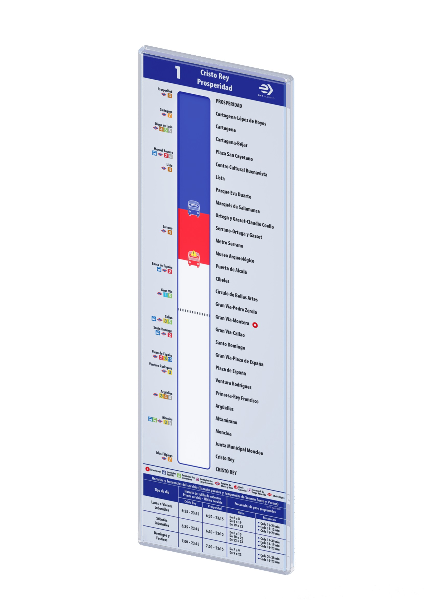 | 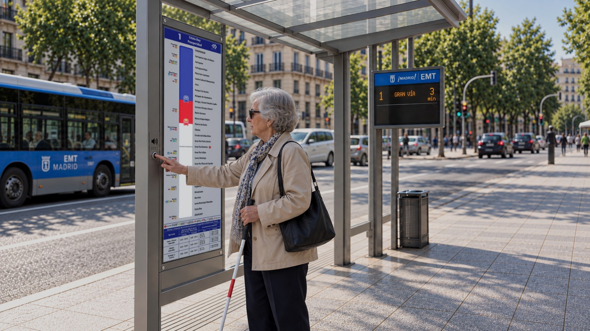 |
| *Fig 1. Conceptual render of the UBIBUS hybrid transit sign.* | *Fig 2. Urban integration showing a passenger interacting with UBIBUS alongside the legacy countdown display.* |

### The Hybrid Analog-Digital Value Proposition
Instead of replacing the traditional vertical paper route diagram ("thermometer" line map) that passengers already understand intuitively, **UBIBUS** merges it with an embedded ultra-wide digital strip (**50 mm × 500 mm**):

* **Contextual Spatial Tracking:** Displays the exact real-time position and movement of each bus directly along the physical sequence of stops.
* **Color-Blind Accessible Status Coding:** Indicates operational state at a glance—**Blue** for normal flow, **Red** for traffic congestion, and **Gray** for out-of-service units—supplemented by specific incident icons, explanatory text at the bottom, and suggested alternative routes.
* **Universal & Zero-Barrier Access:** Embedded directly into the bus stop shelter as public urban furniture, requiring no smartphone, app download, or digital literacy, and featuring an integrated **tactile audio-readout button for visually impaired users**.
* **Fail-Safe Resilience:** Because the stop sequence, origin, and destination remain printed on the physical paper poster framing the screen, the sign retains its core informational utility even during a complete power or telecom outage.

---

## 2. Phase 1: Design Thinking & Low-Cost Mechanical MVP (Oct 2025)

Following collaborative ideation, user persona mapping, and *Design Thinking* workshops, our team divided responsibilities to maximize impact. I led the **physical prototyping strategy** as well as the **financial budgeting and business model validation**.

For the initial pitch competition at Universidad Politécnica de Madrid (October 2025), we operated without external funding. Applying lean Minimum Viable Product (MVP) principles, I engineered a highly visual, low-cost mechanical prototype (**under €30 total budget**) to tangibly demonstrate the core hybrid interface to the jury:

* **Hybrid Board Architecture:** Mounted a modified printed route poster with a precision vertical cutout onto a structural plywood backing board.
* **3D-Printed Kinematic Bus Sliders:** Modeled custom bus icons in **Autodesk Inventor** equipped with lateral actuation rods, allowing smooth manual vertical sliding along the route cutout during the live pitch, complete with interchangeable color-coded inserts (blue for normal flow, red for traffic jams).

| Phase 1 MVP Fabrication | Custom 3D-Printed Bus Sliders (CAD) |
| :---: | :---: |
| 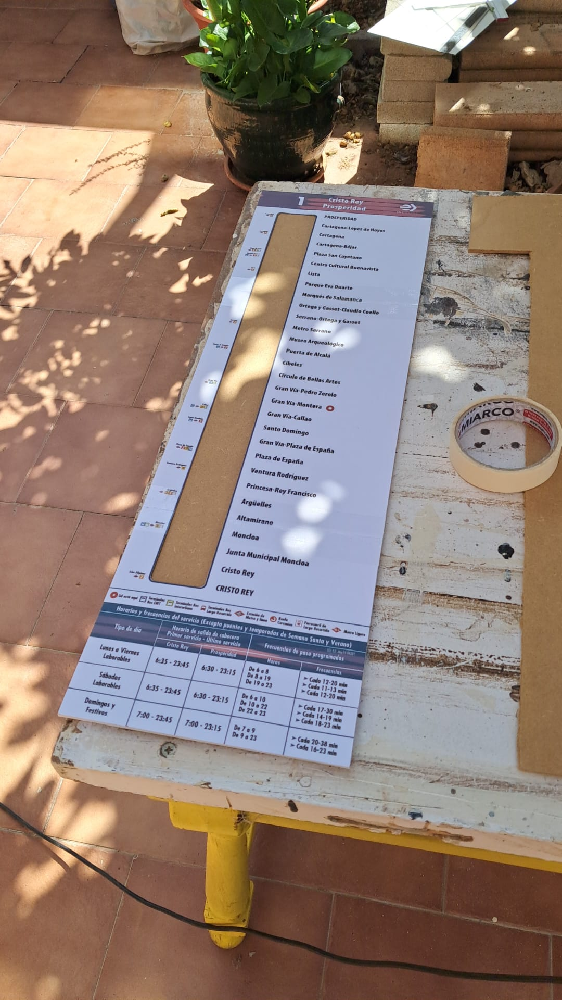 | 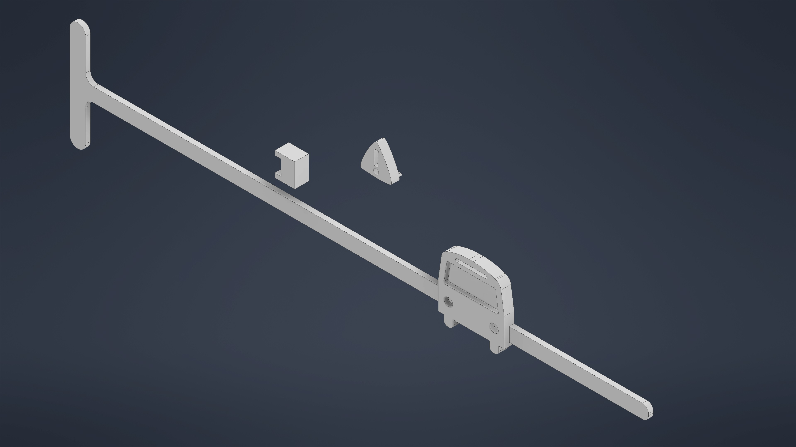 |
| *Fig 3. Workshop fabrication of the low-cost hybrid MVP on a plywood base.* | *Fig 4. Autodesk Inventor CAD model of the manually actuated sliding bus indicators.* |

### Phase 1 Outcome — 1st Prize Winner
The tangible clarity of the mechanical prototype made our pitch stand out, securing **1st Prize at UPM**, seed funding to build a functional electronic prototype, and a spot as finalists at the European **Ford Smart Mobility Accelerator** in Valencia.

| Live Pitch Demonstration (2025) | Jury Q&A Session | 1st Prize Award Ceremony |
| :---: | :---: | :---: |
| 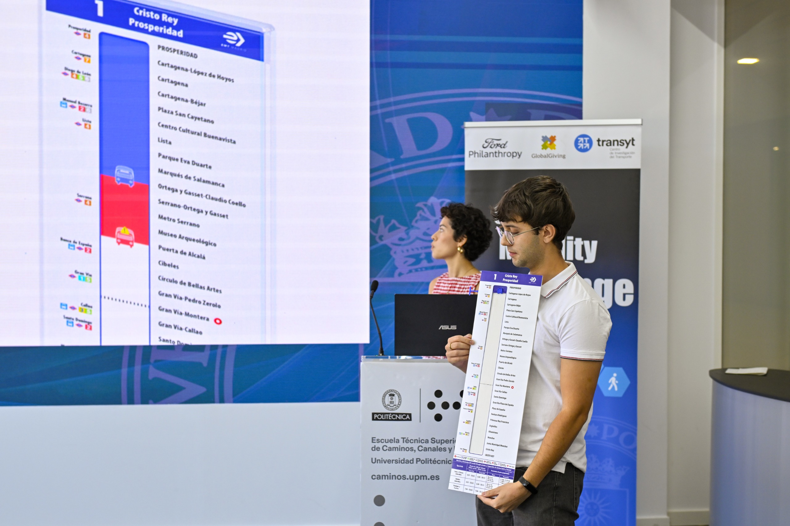 | 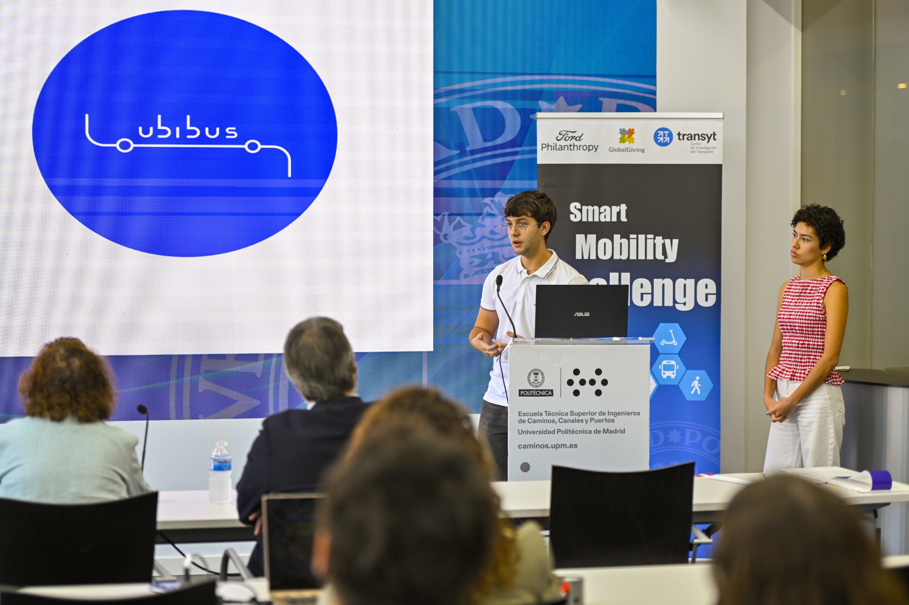 | 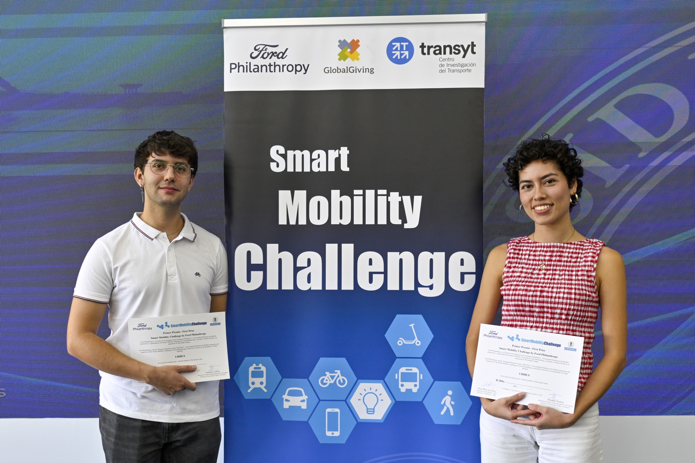 |
| *Fig 5. Demonstrating the manual sliding MVP during the 2025 pitch.* | *Fig 6. Defending the technical and financial viability before the jury.* | *Fig 7. Receiving the 1st Prize award at UPM.* |

---

## 3. Phase 2: Distributed Hardware Engineering & Functional Prototype (Oct 2026)

Advancing to the European finale in Valencia required building a fully functional, full-scale electronic prototype integrating a custom **50 mm × 500 mm ultra-wide display** running interactive transit software alongside the printed poster and protective acrylic face.

### The Distributed Engineering & Logistics Challenge
During this phase, our team operated across three European cities: I had relocated to **Zurich** (with my personal FFF 3D printer), Lucía was in **Madrid**, and Mafe was in **Berlin**. 

To avoid risking damage to the fragile 500 mm LCD panel on international flights, we shipped the screen directly to Madrid so Lucía could program the interface and transport it safely by high-speed train to Valencia. Consequently, I had to **design, manufacture, and pre-assemble the entire structural frame and electronic enclosure in Zurich without physical access to the screen**, governed by three strict engineering constraints:
1. **Remote Metrology & Tolerance Chains:** All mating interfaces for the screen and cabling were designed in CAD from remote measurements taken in Madrid. Because final integration would happen in Valencia just 24 hours before the pitch, I engineered deliberate **clearance tolerance stacks and adjustable retention margins** to guarantee first-time assembly success.
2. **Build Volume Partitioning:** The >500 mm enclosure had to be printed on a compact desktop FFF machine (**220 × 220 × 300 mm** build volume).
3. **Airline Carry-On Transportability:** The entire structural totem and housing had to pack flat inside a standard cabin suitcase for the flight from Zurich to Valencia.

| 50 × 500 mm Ultra-Wide Display | 2026 Prototype CAD (Front View) | 2026 Prototype CAD (Rear View) |
| :---: | :---: | :---: |
| 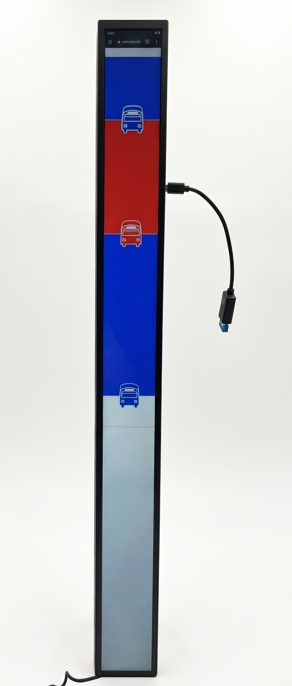 | 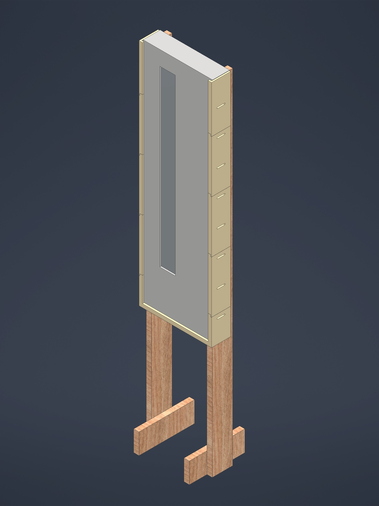 | 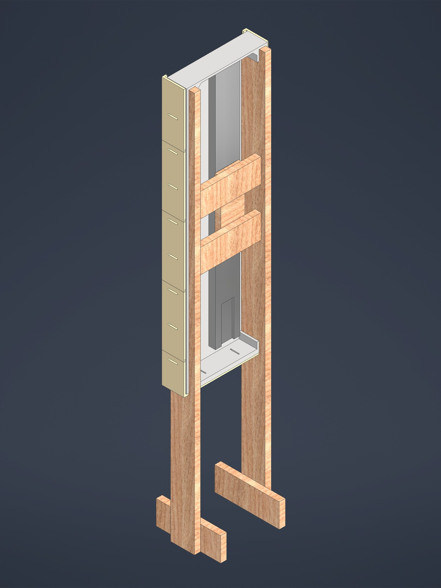 |
| *Fig 8. Custom 50 × 500 mm display running the UBIBUS software interface.* | *Fig 9. Full Autodesk Inventor CAD assembly (front hybrid interface).* | *Fig 10. Rear CAD view showing internal structural ribs and hardware housing.* |

---

## 4. DFAM Enclosure Fabrication & Modular Structure

### Multi-Part 3D-Printed Enclosure with Dovetail Joints
To overcome the 220 × 220 mm print bed limit while maintaining structural rigidity across a half-meter span, I designed the PLA housing as a modular multi-piece assembly connected via **interlocking dovetail joints (*colas de milano*)**. 

Once printed and mechanically interlocked, the seams were bonded and filled using a custom composite filler paste made of **fine wood dust and PVA adhesive**, followed by multi-stage sanding and white surface finishing to achieve a unified monolithic bezel.

| Segmented PLA Enclosure Assembly | Interlocking Dovetail Joint Detail | Seam Filling & Surface Finishing |
| :---: | :---: | :---: |
| 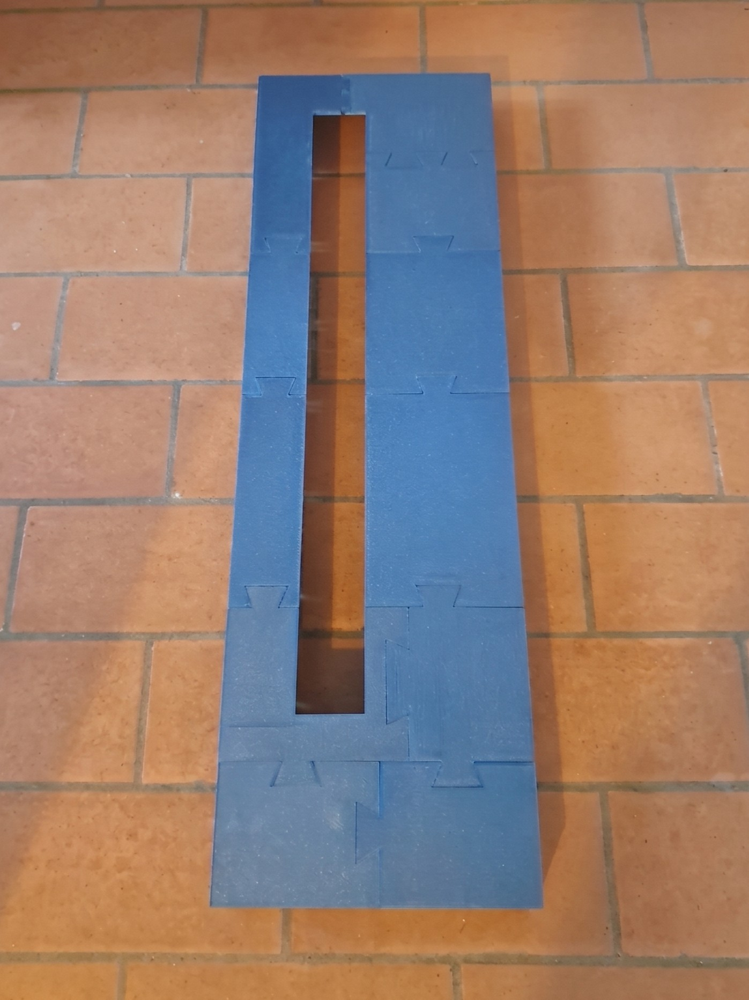 | 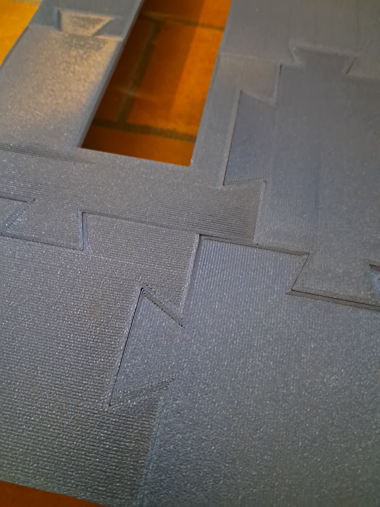 | 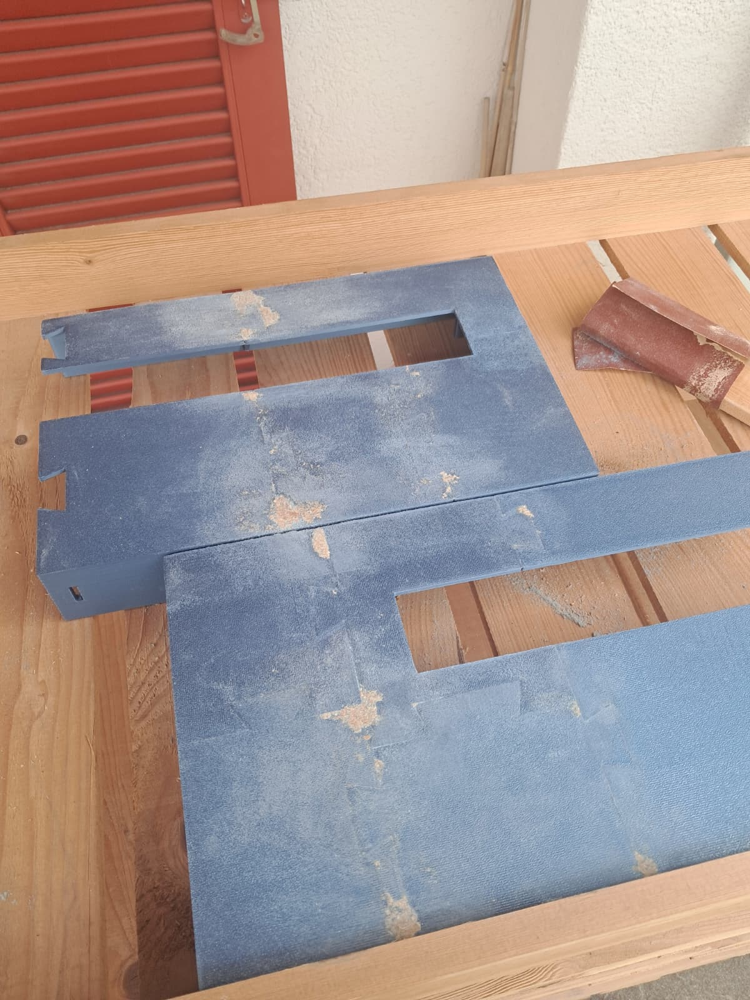 |
| *Fig 11. Full-scale PLA enclosure assembled from segmented prints.* | *Fig 12. Close-up of the interlocking dovetail geometry engineered for alignment.* | *Fig 13. Gap filling with wood-dust/PVA paste and surface sanding prior to painting.* |

### Upcycled Structural Frame & Knock-Down Luggage Joints
Operating with basic hand tools shortly after relocating to Zurich, I reclaimed solid wood boards from a discarded street shelf to build the structural totem. The upper chassis was permanently joined in Zurich using wooden dowels (*tacos*), screws, and PVA wood glue. 

To fit the tall vertical legs inside a carry-on suitcase, I designed a **split two-piece leg architecture** joined via custom **3D-printed structural splice plates (*pletinas*) and bolted fasteners**, enabling rapid, rigid reassembly in Valencia.

| Reclaimed Wood Stock Preparation | Upper Frame Joinery (Dowels & Glue) | Cured Upper Chassis | Carry-On Splice Plate Joint |
| :---: | :---: | :---: | :---: |
| 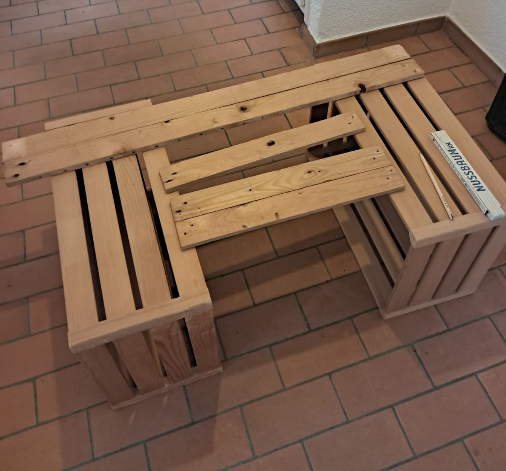 | 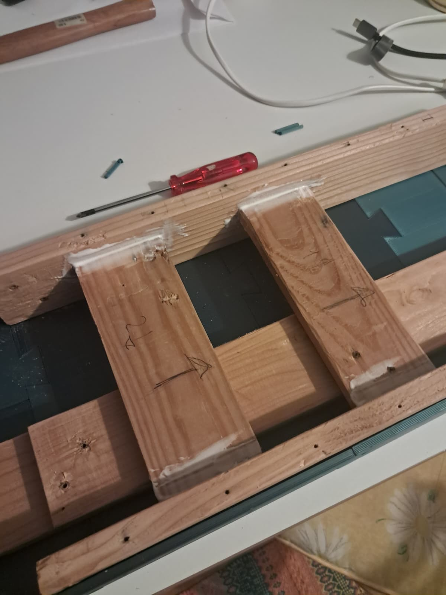 | 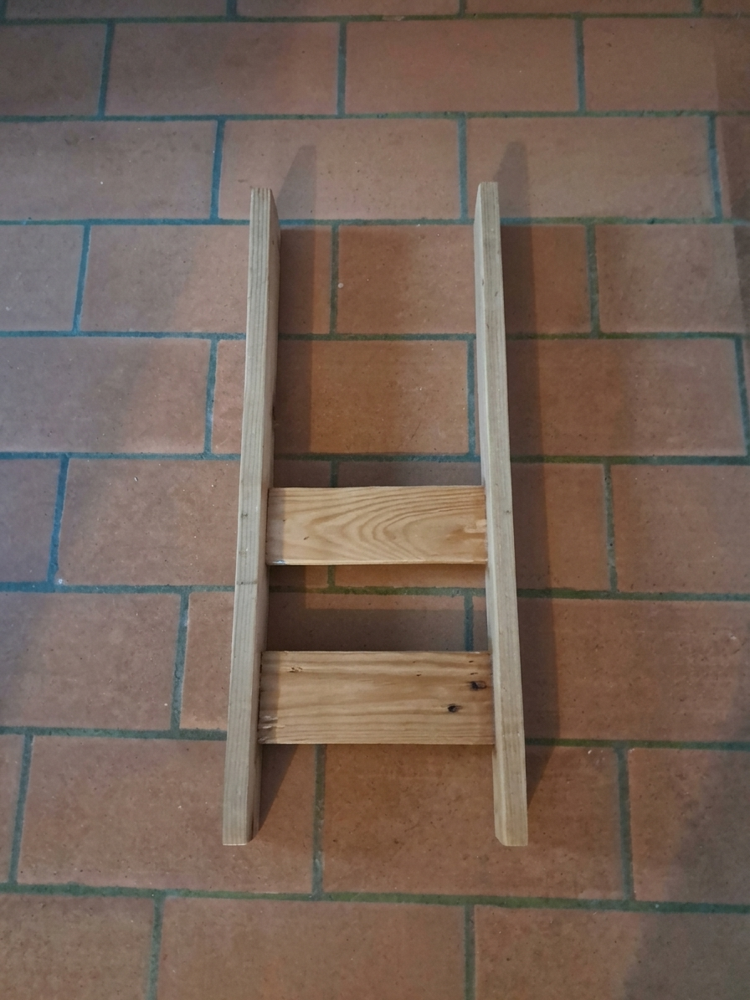 | 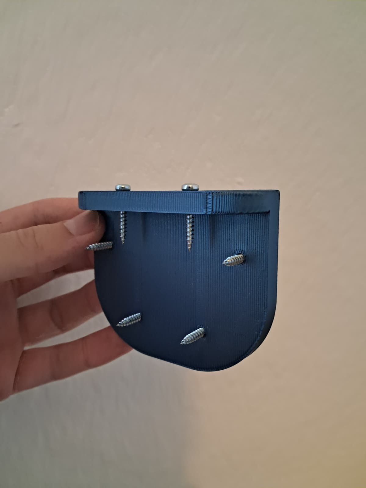 |
| *Fig 14. Upcycled wood boards cut to size.* | *Fig 15. Upper frame joined with dowels, screws, and PVA glue.* | *Fig 16. Consolidated upper structural assembly.* | *Fig 17. Bolted 3D-printed splice plate enabling suitcase transport.* |

---

## 5. Final Integration & Ford Smart Mobility Accelerator (Valencia 2026)

Twenty-four hours before the final pitch in Valencia, the mechanical structure flown in from Zurich met the electronic hardware arriving from Madrid. Thanks to the pre-calculated tolerance allowances, the 50 × 500 mm screen, printed route poster, and protective front PMMA (acrylic) sheet fitted cleanly into the housing on the first attempt.

| Final Pre-Pitch Integration (Valencia) | Live Interactive Demonstration at the Accelerator |
| :---: | :---: |
| 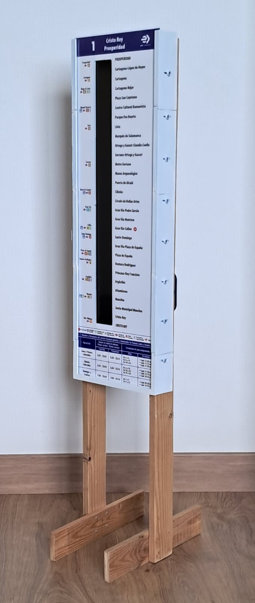 | 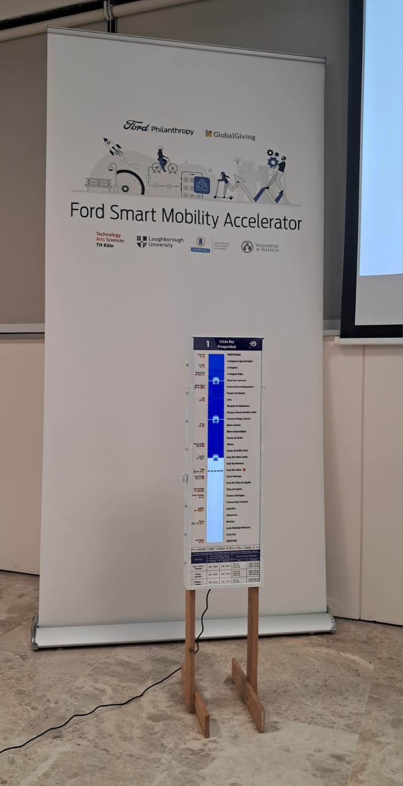 |
| *Fig 18. Complete hardware-software integration in Valencia one day prior to the event.* | *Fig 19. Functional prototype running live during the 2026 European finale.* |

### Live Prototype Operation & Team
The functional prototype enabled a dynamic, interactive pitch alongside the top winning university teams from across Europe, earning strong praise from the jury and mentors for bridging physical industrial design, hardware robustness, and real-world urban empathy.

| Live Prototype Video (2026 Finale) | The UBIBUS Team |
| :---: | :---: |
| <video width="100%" controls><source src="Fig21.mp4" type="video/mp4">Your browser does not support the video tag.</video> | 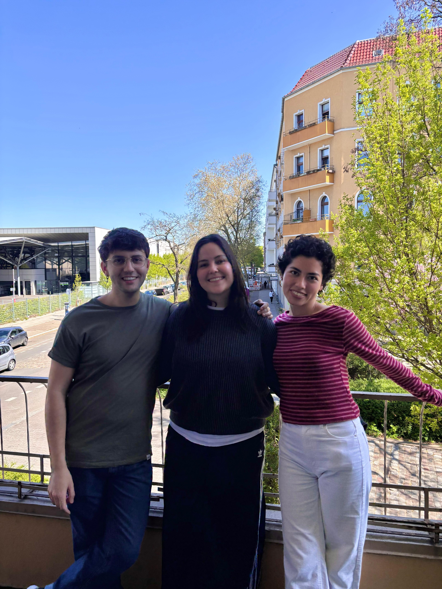 |
| *Fig 20. Video demonstration of the hybrid digital-analog display in active operation.* | *Fig 21. The UBIBUS team in Valencia (from left to right: Pablo, Mafe, and Lucía).* |

---

[← Back to Main Portfolio](../../)