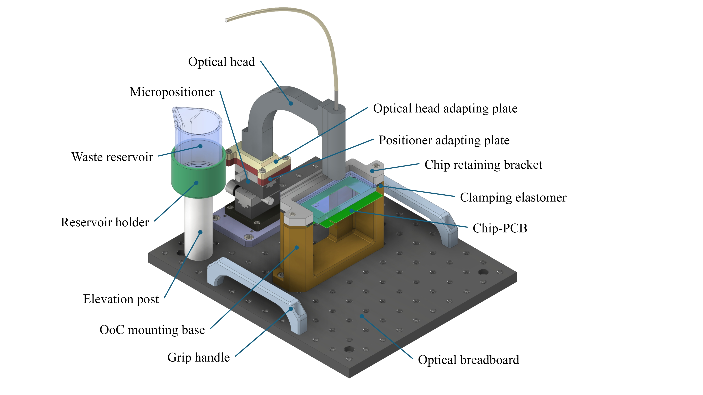
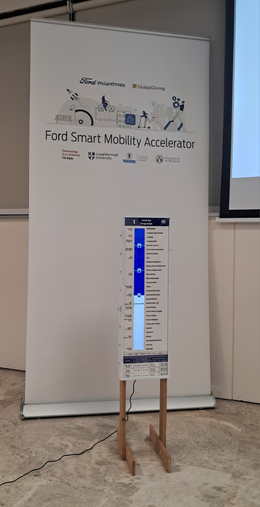
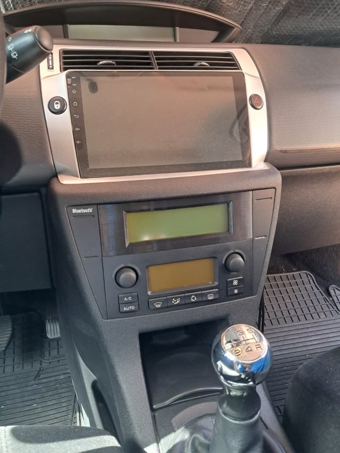

# Pablo Aparicio Martín

Mechanical design, product development and rapid prototyping.

Welcome! I'm a Mechanical and Industrial Design Engineer from Spain, currently living in Zurich. Here you can find a selection of my academic and personal projects, from laboratory instrumentation to urban mobility and automotive interiors. Each project documents the full process: problem, design decisions, prototyping, and the final result.

**Contact:** [pabloaparicio8@gmail.com](mailto:pabloaparicio8@gmail.com)

<!-- TODO (optional): add a 1-2 line bio (studies, interests, location), a profile photo, and contact links (email, LinkedIn, CV in PDF). -->

## Projects

  <a class="card" href="./content/biomedical_platform/">
    
    

      <h3>Tales Biomedical Platform</h3>
      
Modular optomechanical platform with laser micro-positioning for Organ-on-a-Chip biosensing. Designed, calibrated and 3D printed for the Center for Biomedical Technology (CTB-UPM), where it is in active use.

      
Optomechanical designDFAMPETG

      View project →
    

  </a>

  <a class="card" href="./content/ubibus/">
    
    

      🏆 1st Prize · European Finalist
      <h3>UBIBUS</h3>
      
Hybrid digital-analog sign for bus stops that merges the printed route map with a real-time digital strip. Won the Ford Smart Mobility Challenge (UPM) and reached the European finale in Valencia.

      
Human-centered designPrototypingBusiness model

      View project →
    

  </a>

  <a class="card" href="./content/automotive_retrofit/">
    
    

      <h3>Automotive Retrofit</h3>
      
Display relocation bezel and dual-USB console hub for a 2008 Citroën C4. Reverse engineered, modeled in Inventor and printed in heat-resistant PETG with snap-fit retention.

      
Reverse engineeringSnap-fitPETG

      View project →
    

  </a>

## Skills & Tools

<strong>Design & CAD</strong> Autodesk Inventor, technical drawings, Inkscape

<strong>Manufacturing</strong> FDM/FFF 3D printing (PLA, PETG), OrcaSlicer calibration, DFMA / DFAM

<strong>Process</strong> Design Thinking, Total Design (PDS, Pugh matrices), rapid prototyping

<strong>Workshop</strong> Thread tapping, woodworking, surface finishing

